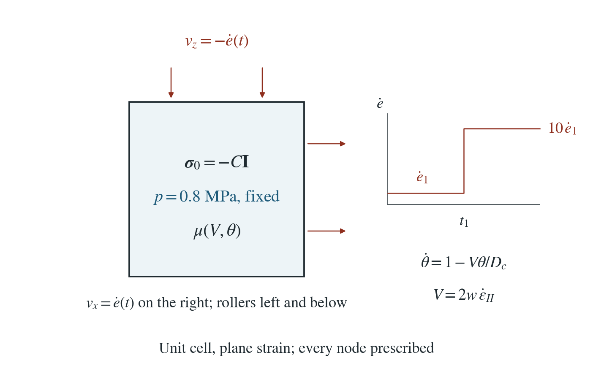
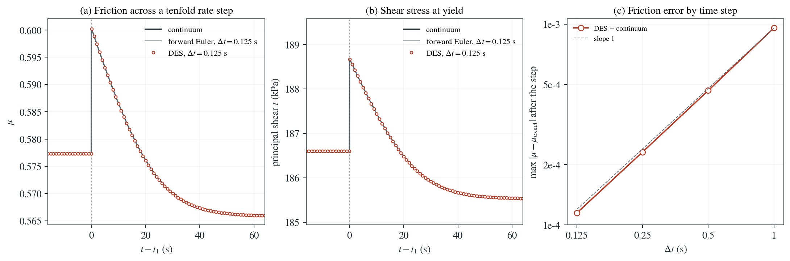

# Rate-and-state friction under a velocity step

A pressurized cell sheared at yield sees its loading rate rise tenfold. Rate-and-state friction jumps by $a\ln10$, then decays over the slip distance $D_c$ to the new steady state ($b>a$: velocity weakening).

**DES follows its exact discrete recursion to round-off at every step (state and friction identical, stress within 9e-16), so the state is updated once per physical time step, not once per PT iteration. Against the continuum solution the largest friction error after the step is 9.56e-04, 4.67e-04, 2.31e-04, 1.15e-04 for steps of 1, 0.5, 0.25, 0.125 s: first order, against a jump of 0.0230.**

:::info At a glance

| | |
| --- | --- |
| Dimension | 2D |
| Build | `make ndims=2` from the poromechanics source |
| Inputs | [rsf.zip](/downloads/poromechanics/rsf.zip) |
| Checked with | DynEarthSol `97f9794` (poromechanics branch) |

:::

## Problem setup



**Cell.** The material-strength unit cell: every node prescribed, normal extension rates $\pm\dot e$, plane strain, initial stress $-C\mathbf{I}$ with $C=1$ MPa and a fixed pore pressure of 0.8 MPa ($\alpha=1$), cohesion 100 kPa, no dilation.

**Friction.** EP-RSF with the aging law: $a=0.01$, $b=0.015$, $D_c=1$ mm, $\mu_0=\tan30^\circ$, $V_0=V_1$, so the cell starts and stays at steady state; slip rate $V=2w\dot\epsilon_{II}$ (total-strain-rate projection).

**Rate step.** After 64 s at $\dot e_1=7.8\times10^{-6}\ \mathrm{s^{-1}}$ the cell restarts from its last checkpoint at $10\dot e_1$ for another 64 s.

**What is compared.** Friction, state and principal shear stress at every step against the exact discrete recursion and the continuum solution, for steps of 1, 0.5, 0.25 and 0.125 s.

## Input and how to run

Every file this example needs is in [rsf.zip](/downloads/poromechanics/rsf.zip). Run from that folder:

```bash
# Loads the 2D cell at the slow rate for 512 steps of 0.125 s (64 s) and writes cell.save.* and cell.chkpt.* at every step; the last checkpoint (frame 512) is the starting point of the second stage.
dynearthsol2d input.cfg
# Restarts from cell frame 512 with ten times the boundary velocity and runs to step 1024 (another 64 s), writing step.save.*; no checkpoint is shipped, so the first stage must be run first.
dynearthsol2d step.cfg
```

### Settings that define this example

| Setting | Value | What it does here |
| --- | --- | --- |
| `mat.rheology_type` | `elasto-plastic-rate-state-friction` | elasto-plastic-rate-state-friction: Mohr–Coulomb plasticity whose friction coefficient follows rate-and-state friction |
| `mat.state_var_model` | `1` | 1: aging law for the state variable θ |
| `mat.direct_a` | `[0.01]` | direct-effect parameter a = 0.01: the instant friction jump at the rate step is a ln 10 |
| `mat.evolution_b` | `[0.015]` | evolution parameter b = 0.015 &gt; a, so the material is velocity weakening and the new steady friction is lower by (b − a) ln 10 |
| `mat.characteristic_distance` | `[0.001]` | slip distance D_c = 1 mm over which friction relaxes to the new steady state |
| `mat.characteristic_velocity` | `[1.1048543456039805e-05]` | reference slip rate V0, set equal to the initial slip rate V1 so the cell starts at steady state with μ = tan 30° |
| `control.rsf_slip_rate_projection_option` | `1` | 1: slip rate V = 2w ε̇_II from the total deviatoric strain rate (w is the element's minimum altitude) |
| `monitor.output_state_variable` | `true` | writes the state variable and the dynamic friction coefficient to every frame |
| `bc.vbc_val_x1` | `7.8125e-06` | extension rate of the cell (right face velocity); step.cfg multiplies it by 10 |
| `bc.vbc_val_z1` | `-7.8125e-06` | equal shortening rate on the top; step.cfg multiplies it by 10 |
| `ic.pore_pressure_value` | `800000.0` | fixed pore pressure 0.8 MPa (uniform, pore_pressure_option 2) |
| `ic.initial_stress` | `[-1000000.0, -1000000.0, 0.0]` | isotropic total stress of −1 MPa |
| `control.fixed_dt` | `0.125` | time step 0.125 s, the finest step of the study |
| `sim.checkpoint_frame_interval` | `1` | 1: a checkpoint at every frame, so the rate step can restart from the last one |

[input.cfg](/downloads/poromechanics/rsf/input.cfg) holds all 70 settings that differ from DES’s defaults; `dynearthsol2d -h` lists every option with its default.

## Output

DES writes `cell.info` (one line per saved frame: frame, step, time in seconds), `cell.save.NNNNNN` (the fields of each saved frame) and `cell.chkpt.NNNNNN` (checkpoints to restart from). `sim.output_step_interval` and `sim.output_time_interval_in_yr` set how often a frame is saved.

Set `DES_SOURCE` and `PYTHONPATH` as described in [Running the examples](../running.md) before using the Python reader or converter.

| Field | What to look at |
| --- | --- |
| `dynamic friction coefficient` | element friction coefficient μ, plotted across the rate step in panel (a) |
| `friction state variable` | element state θ; compared with the exact forward-Euler recursion at every step |
| `stress` | element total stress; half the principal-stress difference is the shear stress at yield in panel (b) |

Read a frame in Python:

```python
from Dynearthsol import Dynearthsol      # in the DES source folder
model = Dynearthsol('cell')
frame = model.frames[-1]                 # model.time[i] is the time of frame i, in seconds
x = model.read_field(frame, 'coordinate')
value = model.read_field(frame, 'dynamic friction coefficient')
```

View it in ParaView after `python3 "$DES_SOURCE/2vtk.py" cell`.

## Result: DES and the analytical solution



(a) Friction coefficient across the tenfold step in loading rate, against time from the step: solid line, continuum solution; thin stepped line, the forward-Euler recursion at the same time step; symbols, DES at the finest time step. (b) Principal shear stress at yield, which follows the friction coefficient through the Mohr–Coulomb load. (c) Largest friction error against the continuum solution after the step, for each time step, with a first-order reference slope.

This verifies the evolving rate-and-state friction of the effective-stress plasticity, which the strength page checks only at constant friction.

To reproduce the whole study behind this figure, from the DES source folder:

```bash
python3 tests/functional/hydromechanics/check_rsf_step.py dynearthsol2d OUT --refinements 1 2 4 8
```

The study’s full numbers: [record.json](/downloads/poromechanics/rsf/record.json).

## Analytical reference

$$
\mu=\mu_0+a\ln\frac{V}{V_0}+b\ln\frac{V_0\theta}{D_c}
$$

$$
\dot\theta=1-\frac{V\theta}{D_c}
$$

$$
\theta(t)=\frac{D_c}{V_2}+\left(\frac{D_c}{V_1}-\frac{D_c}{V_2}\right)e^{-V_2(t-t_1)/D_c},\quad t>t_1
$$

$$
\tau=\min\left(2G\,e,\ c\cos\phi+(C-\alpha p)\sin\phi\right),\quad \tan\phi=\mu
$$

$\theta$ is the state variable, $V$ the slip rate, $w$ the element's minimum altitude and $\tau$ half the principal-stress difference. DES advances $\theta$ by forward Euler, once per physical step.

### Derivation

With $V$ held constant the aging law is linear in $\theta$ and integrates to the exponential above; at $t_1$ friction jumps by $a\ln10$ through the direct effect and relaxes to the new steady state, a net change of $(a-b)\ln10$.

With every node prescribed and no dilation, the stress is elastic until yield and then equals the Mohr–Coulomb load at the current friction. The discrete reference repeats DES’s forward-Euler update; the continuum one is exact.

Dieterich (1979), Journal of Geophysical Research 84(B5), 2161–2168; Ruina (1983), Journal of Geophysical Research 88(B12), 10359–10370.

[Original reference](https://doi.org/10.1029/JB084iB05p02161).

## Validity and limits

Aging law and the total-strain-rate slip projection only; constant pore pressure; no dilation, no elastic interaction (every node prescribed), so stick–slip instability is not tested.

## Reproduction

[Commands, solver hashes and portable inputs](../running.md).
