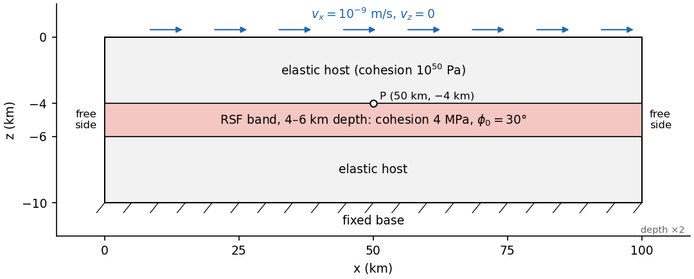
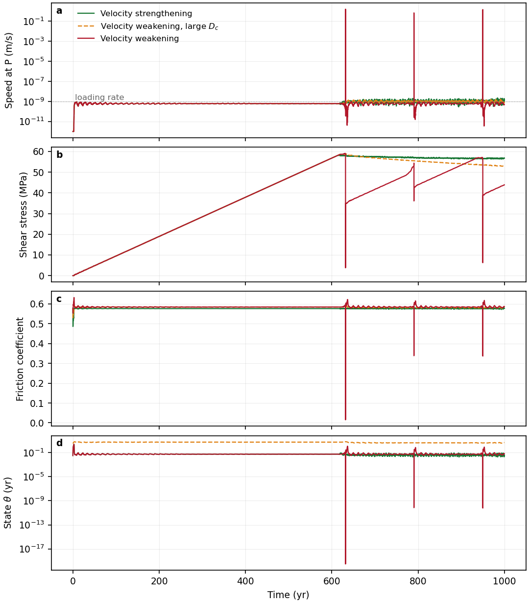
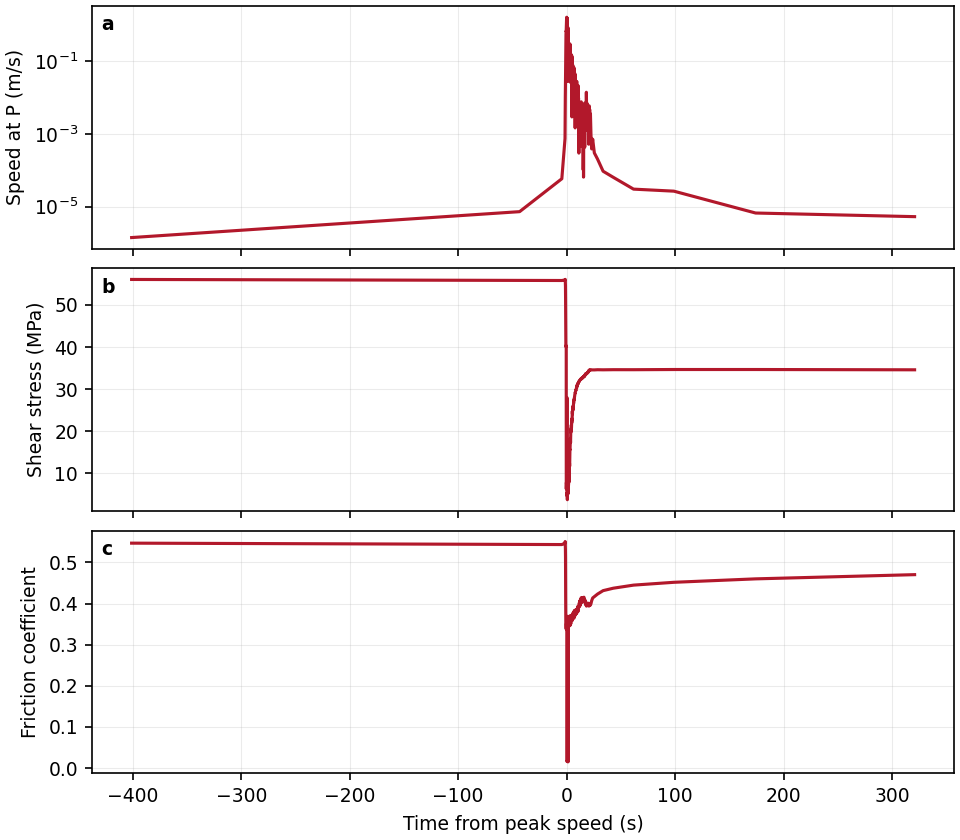

# Creep or earthquakes

A frictional fault either creeps steadily or locks and fails in repeated
earthquakes. Rate-and-state friction decides which through two quantities:
the sign of $a-b$ and the characteristic slip distance $D_c$. This tutorial
runs the three examples shipped in `examples/rate_and_state_friction/`,
which differ only in those parameters, for 1000 years each:

| Case | $a$ | $b$ | $a-b$ | $D_c$ | Outcome |
| --- | ---: | ---: | ---: | ---: | --- |
| `ep_rsf_creep` | 0.006 | 0.003 | +0.003 | 1 mm | steady creep |
| `ep_rsf_eq` | 0.003 | 0.015 | −0.012 | 1 mm | three earthquakes |
| `ep_rsf_creep_largeDc` | 0.003 | 0.015 | −0.012 | 100 mm | slow creep, no earthquake |

The same model also shows how global velocity scaling carries one
simulation through centuries of loading and seconds of rupture. See
[rate-and-state friction](../../theory/rate-state-friction.md) for the
equations and for global velocity scaling.

## Setup



*Figure 1.* The model, with depth exaggerated twice. The top moves right at
the loading rate and the base is fixed. P is the monitor point on the top
of the band at x = 50 km.

| Setting | Value |
| --- | --- |
| Domain | 100 km × 10 km (2D), gravity 10 m/s² |
| Band | 4–6 km depth, full width, rate-and-state friction |
| Hosts | above and below the band; cohesion $10^{50}$ Pa keeps them elastic |
| Elastic moduli and density | $K$ = 50 GPa, $G$ = 30 GPa, 2700 kg/m³ |
| Band strength | cohesion 4 MPa, $\phi_0$ = 30°, no dilation, no weakening |
| RSF | aging law, $V_0 = 10^{-9}$ m/s, $a$, $b$ and $D_c$ as in the table above |
| Loading | top: $v_x = 10^{-9}$ m/s (3.2 cm/yr), $v_z = 0$; base fixed; sides free |
| Mesh | `rsf_long_strike_model_low_resolution.poly`; about 215 m elements in the band, 300 m in the hosts; 32,091 elements |
| Mechanics | explicit, global velocity scaling with $c = 10^5$, damping option 1 |

The `.poly` file divides the band into three regions (material IDs 3, 2, 1
from left to right) so that the central 10 km can be given different
friction. In these examples all band materials share the same $a$ and $b$.

## Input and how to run

Build `dynearthsol2d` in the DES root. Then:

```bash
cd examples/rate_and_state_friction
python3 run_rsf_examples.py --exe ../../dynearthsol2d
python3 plot_rsf_time_series.py -o rsf_time_series.png
```

The runner creates one output folder per case and runs the three inputs one
after another. On a laptop each case takes about 10 minutes with three
OpenMP threads (`OMP_NUM_THREADS=3`). You can also run a single case
directly:

```bash
mkdir -p ep_rsf_eq
OMP_NUM_THREADS=3 ../../dynearthsol2d ep_rsf_eq.cfg
```

The settings that matter for the cycle are:

```ini
[sim]
max_time_in_yr = 1000
output_time_interval_in_yr = 100     # regular frames
earthquake_output_step_interval = 500 # extra frames during an event
earthquake_start_factor = 5.0        # event: fastest speed > 5 x boundary speed, and > 1e-6 m/s
earthquake_end_factor = 2.0

[control]
use_global_velocity_scaling = true
inertial_scaling = 1e5
damping_option = 1

[mat]
rheology_type = elasto-plastic-rate-state-friction
direct_a = [0.003, 0.003, 0.003, 0.003, 0.003]
evolution_b = [0.015, 0.015, 0.015, 0.015, 0.015]
characteristic_velocity = [1e-9]
characteristic_distance = [1e-3]
state_var_model = 1                   # aging law

[monitor]
enabled = yes
step_interval = 10
points_x = [50]
points_y = [-4.0]                     # z in 2D
points_unit = km
output_velocity = yes
output_stress = yes
output_dynamic_friction = yes
output_state_variable = yes
```

## Output

Each case writes to its own folder (`ep_rsf_eq/`, `ep_rsf_creep/`,
`ep_rsf_creep_largeDc/`):

- `<case>.save.*` field frames: one every 100 years, plus one every 500
  steps while an event is under way. The earthquake case has 40 frames
  (about 0.7 GB), the creep cases 11 (about 0.2 GB).
- `<case>.chkpt.*` checkpoints for restarting.
- `<case>.info`: one line per frame with the step, time (s) and time step
  (s).
- `monitor_point_0.csv`: the history at P every 10 steps, with
  `velocity_x`, `velocity_z`, `stress_0`–`stress_2` (σxx, σzz, σxz),
  `dynamic_friction` and `state_variable`.

`plot_rsf_time_series.py` plots the speed and displacement at P for all
three cases. To read the monitor yourself:

```python
import numpy as np
d = np.genfromtxt('ep_rsf_eq/monitor_point_0.csv', delimiter=',', names=True)
year = 365.2422 * 86400
t = d['time_s'] / year
speed = np.hypot(d['velocity_x'], d['velocity_z'])
shear = np.abs(d['stress_2']) / 1e6          # MPa
dt = np.diff(d['time_s']) / np.diff(d['step'])
print(f'{speed.max():.2f} m/s peak; dt from {dt.min():.2g} to {dt.max():.2g} s')
```

## Result



*Figure 2.* Histories at P for the three cases: (a) speed, (b) shear stress
σxz, (c) friction coefficient, (d) state variable.

**Loading (0–620 years).** All three cases are identical. The band is still
below its Mohr–Coulomb strength, so it deforms elastically, the friction
law has no effect, and shear stress at P rises linearly. P moves at about
0.6 of the loading rate, its share of the elastic shear across the 10 km
column.

**After yield (from about 620 years)** the cases separate:

- **Velocity strengthening** ($a-b>0$). The band creeps at the loading rate
  and the shear stress stays near 57 MPa. Any acceleration raises friction
  and damps itself.
- **Velocity weakening** ($a-b<0$, $D_c$ = 1 mm). The band fails in three
  earthquakes, at 632, 791 and 950 years, about 159 years apart. Peak speed
  at P is 0.7–1.6 m/s. Shear stress at P drops by 11–21 MPa in each event
  and then reloads.
- **Velocity weakening with large $D_c$** (100 mm). The band yields and then
  creeps while its stress slowly declines, from 59 to 53 MPa by 1000 years.
  No event occurs. With a 100 times larger $D_c$, weakening is spread over
  100 times more slip, and the critical stiffness $k_c=(b-a)\sigma/D_c$
  falls by the same factor, which favours stable sliding.



*Figure 3.* The first earthquake at P, from 400 s before to 300 s after
peak speed: (a) speed, (b) shear stress, (c) friction coefficient.

**Inside an event.** Speed at P rises from about $10^{-5}$ m/s to 1.6 m/s
in the last few seconds before the peak, and stays above 1 mm/s for about
12 s. The friction coefficient
falls from 0.55 to near zero at peak slip rate, because the state collapses
as the band slips many times $D_c$. It then heals back toward 0.45–0.47
within minutes as slip slows. The shear stress swings below its final value
and settles at 35 MPa, a static drop of about 21 MPa.

**Global velocity scaling at work.** In the earthquake case the time step
ranges from $3.9\times10^{5}$ s (4.5 days) during loading to
$4.7\times10^{-3}$ s at peak slip, a factor of $10^{8}$. Each event takes
about 2300–2700 steps; the whole 1000-year run takes 98,000 steps. Without
the scaling the run would need about $10^{13}$ steps at the event time step.

## Things to try

- **Change $a-b$ along the band.** Give the central region (material 2) a
  velocity-weakening $a-b$ and the flanks (materials 1 and 3) a
  velocity-strengthening one, as in the
  [shear-band tutorial](./rate-state-friction.mdx). Events then nucleate in
  the centre and stop in the flanks.
- **Vary $D_c$ between 1 and 100 mm.** Find the value at which the
  earthquakes stop. Compare the recurrence interval and peak speed on the
  way.
- **Record seismic moment.** Set `sim.seismic_moment_calculate_output = yes`
  to write event start and end times to `seismic_moment_magnitude.txt`.
- **Limit the state change per step.** Add
  `control.rsf_slip_rate_projection_option = 1` and
  `control.rsf_dtheta_max = 0.5` and check how much the event changes.

## Limits

- **One point.** The monitor records the velocity of P on the top of the
  band, not the slip rate across it. Use the saved fields to see where an
  event starts and how far it spreads.
- **Resolution.** The band elements (about 215 m) are much larger than the
  nucleation length $L_b = G'D_c/(b\sigma)$ of the 1 mm case, about 20 m
  for the lithostatic normal stress at 5 km depth. Event timing and size here are mesh
  dependent. In the first event the state also reaches its lower bound of
  $10^{-12}$ s.
- **Damped inertia.** Force damping stays on during events, and the
  default shear wave-speed cap keeps the scaled density above the physical
  density. The ruptures are therefore damped, quasi-dynamic events, not
  fully dynamic ones.
- **Slip-rate measure.** These inputs use the default velocity projection
  (`rsf_slip_rate_projection_option = 0`), which reads the element velocity
  rather than the velocity jump across it.
