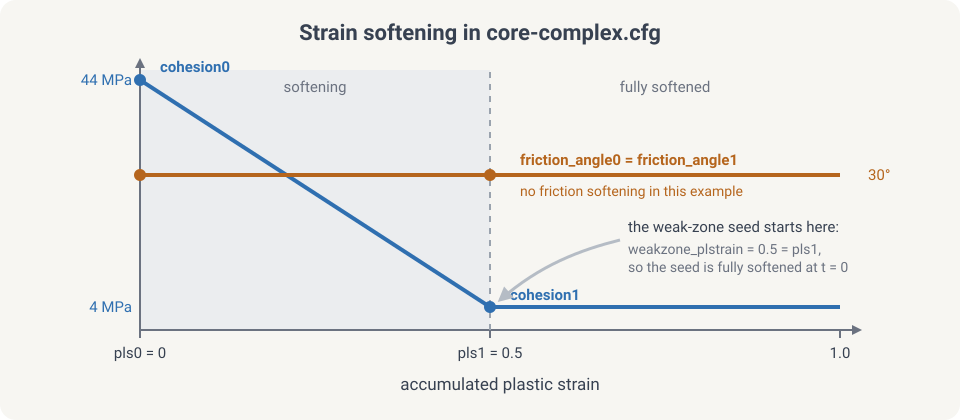
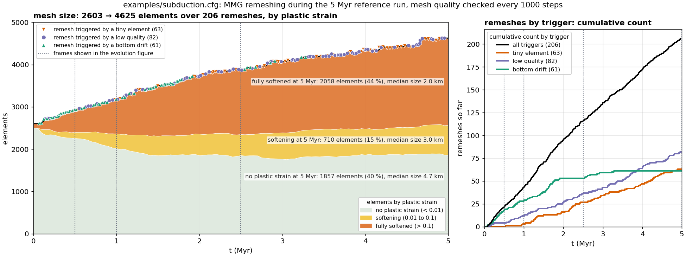
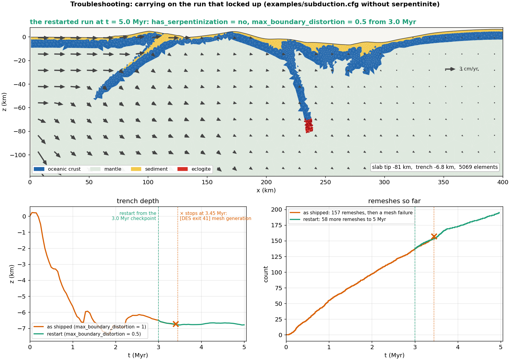

# Tectonic rifting and subduction

This tutorial walks through two classic long-term tectonic models with
DynEarthSol: **rifting** of a brittle crustal layer, which produces a
metamorphic core complex, and **subduction** of an oceanic plate beneath an
overriding plate. Both use bundled 2D examples as a starting point, so you can
run them as they are and then modify one ingredient at a time.

Both cases move material a long way under divergent or convergent forcing.
Deformation localizes where plastic strain accumulates, and with MMG remeshing
the mesh is refined there, so faults stay sharp as the model runs. The first
case takes minutes on a laptop; the second takes hours.

## What you will learn

- How a DES `.cfg` file is organized and which sections matter for tectonics
- How Mohr–Coulomb plasticity with strain softening produces faults, and how
  a weak zone and the wall velocities decide where and how fast
- How a slab-shaped initial geometry is built with a `.poly` file
- How marker phase changes add serpentinite and eclogite as the slab descends,
  and what the virtual-topology grid does for them
- How remeshing keeps a Lagrangian mesh usable, what triggers it, and how MMG
  refines along the faults and the plate interface
- How to read the output: plastic strain, topography, viscosity, temperature,
  material and velocity
- How to diagnose a run that stops in a remeshing failure and carry it on
  from a checkpoint with a changed parameter

## Prerequisites

This tutorial follows the ones before it in this section and uses what they
cover. Before starting, ensure you have:

- ✅ DynEarthSol compiled in 2D (`make ndims=2`); see [Build](../usage/usage.md)
  and [Running DES3D](../usage/run.md)
- ✅ Python 3 with `numpy` for `2vtk.py`, and
  [ParaView](https://www.paraview.org/) or another VTK viewer; see
  [Visualizing outputs](../usage/visualize.md)
- ✅ Read [Making a complex mesh with `.poly` file](./usingpolyfile.md): Part 2
  reads its slab geometry from one
- ✅ Read [Weak zones](./weakzone.md): Part 1 seeds a fault with a planar weak
  zone and Part 2 the plate interface with a segment one
- ⬜ Optional: an MMG build (`make ndims=2 usemmg=1`) for the adaptive-remeshing
  boxes and Exercise 2. MMG is a git submodule that `make` fetches and builds
  for you; see [Adaptive mesh refinement with MMG](./usingmmg.md)

[Velocity boundary conditions (3D)](./vbc.md) and
[Rate-and-state friction](./rate-state-friction.mdx) are not needed here: both
examples are 2D with steady wall velocities and no earthquake cycles. The
next tutorial, [Coupling with GoSPL](./couplinggospl.md), adds surface processes
to models like these.

:::tip Which build?
The examples in this tutorial are 2D. A 3D build (`make`) runs the same
physics at a much higher cost. Every `.cfg` here runs on a plain Triangle
build; the MMG boxes show what changes when you rebuild with
`make ndims=2 usemmg=1`.
:::

## How the model works

DynEarthSol's rheology is built from three responses that can be switched on
per run with `rheology_type`. Part 1 uses `elasto-plastic`; Part 2 adds
viscous creep with `elasto-visco-plastic`.

| Component | Controls | Key parameters | Used in |
|-----------|----------|----------------|---------|
| Elastic | Short-term stress build-up | `bulk_modulus`, `shear_modulus` | Parts 1 and 2 |
| Plastic (Mohr–Coulomb, strain softening) | Brittle faulting | `cohesion0/1`, `friction_angle0/1`, `dilation_angle0/1`, `pls0/1` | Parts 1 and 2 |
| Viscous (power-law creep) | Ductile flow where it is hot | `visc_exponent`, `visc_coefficient`, `visc_activation_energy`, `min_viscosity`, `max_viscosity` | Part 2 only |
| Temperature | Viscosity through creep; density through `alpha` | `temperature_option`, `oceanic_plate_age_in_yr`, `surface_temperature`, `mantle_temperature` | Part 2 only |

### Strain softening

Faults in DES are bands of elements that have yielded. A band localizes only
if the material gets weaker as it deforms: cohesion and friction angle drop
linearly from their `0` values to their `1` values as accumulated plastic
strain goes from `pls0` to `pls1`. Fast softening (small `pls1`) favours one
long-lived fault; slow softening spreads deformation over many short-lived
faults.



### Seeding deformation: the weak zone

In a uniform model nothing selects where the first fault forms, so the
location of localization is uncontrolled and depends on mesh noise. A weak
zone is a region given an initial plastic strain `weakzone_plstrain`, which
pre-softens it and pins the first fault. Part 1 uses a planar seed
(`weakzone_option = 1`), Part 2 a dipping multi-segment one. The other shapes
are described in [Weak zones](./weakzone.md).

### Driving deformation: velocity boundary conditions

`vbc_x0` and `vbc_x1` set the condition type on the left and right walls; type
1 fixes the normal velocity and leaves the shear component free. `vbc_val_x0`
and `vbc_val_x1` are the normal velocities in m/s, positive toward +x, so a
negative value on the left wall and a positive one on the right wall pull the
model apart. The top is a free surface. The bottom carries a Winkler
foundation, a lithostatic normal stress that lets the base move vertically.

### Thermal structure (Part 2)

Part 1 is isothermal. Part 2 sets an initial geotherm by half-space cooling
(`temperature_option = 0`, `oceanic_plate_age_in_yr`), and temperature then
evolves by conduction and advection. It feeds back into the viscosity through
the creep law, which is what makes the deep slab and the mantle wedge flow.

{/* TODO: one sentence each on temperature_option 1-3 for continental geotherms. */}

### Remeshing and markers

A Lagrangian mesh follows the material, so elements distort as faults slip.
When the worst element quality drops below `min_quality` (checked every
`quality_check_step_interval` steps), or a boundary moves by more than
`max_boundary_distortion` × `resolution`, DES rebuilds the mesh and maps the
fields onto it. `remeshing_option = 11` restores the bottom boundary to its
initial depth. Markers carry material identity across remeshes. With MMG the
rebuild is adaptive: elements are sized from accumulated plastic strain, so
faults get finer elements and the quiet far field stays coarse. See
[Remeshing](../theory/remeshing.md) and [MMG](./usingmmg.md).

## Part 1: Rifting a brittle crust (core complex)

The bundled example
[`examples/core-complex.cfg`](https://github.com/GeoFLAC/DynEarthSol/blob/master/examples/core-complex.cfg)
stretches a single 10 km brittle layer with a pre-cut dipping fault. With
strain softening the fault keeps slipping, its footwall rises and rotates,
and the fault surface flattens into a dome. This is the rolling-hinge
mechanism of metamorphic core complexes (Lavier, Buck & Poliakov 1999), and
it is the fastest way to see every ingredient of a DES tectonic run.

| | Setting |
|---|---|
| Domain | 100 × 10 km, 1 km resolution refined in the central 40 km (`meshing_option = 2`, `refined_zonex = [0.3, 0.7]`) |
| Forcing | ±1e-9 m/s (3.15 cm/yr per side, 6.3 cm/yr total) extension in x |
| Duration | 50 kyr as shipped (3.2 km of total extension), output every 1.5 kyr |
| Rheology | `elasto-plastic`, one material (ρ = 2700 kg/m³), cohesion 44 → 4 MPa over 0.5 plastic strain, friction 30° fixed |
| Weak zone | Planar (`weakzone_option = 1`), dipping 60°, 1.2 km half-width, in the lower half of the layer at x = 50 km |
| Surface | Hillslope diffusion, `surface_diffusivity = 1e-7` m²/s |
| Thermal | Isothermal, 273 K |



### Step 1: Walk through the configuration

```cfg title="core-complex.cfg"
[sim]
modelname = result3
max_time_in_yr = 50000
output_time_interval_in_yr = 1500
has_output_during_remeshing = no
is_outputting_averaged_fields = no

[mesh]
meshing_option = 2
xlength = 100e3
ylength = 10e3
zlength = 10e3
resolution = 1e3
largest_size = 10
smallest_size = 0.01
refined_zonex = [0.3, 0.7]
refined_zoney = [0.0, 1.0]
refined_zonez = [0.0, 1.0]
quality_check_step_interval = 500
remeshing_option = 11

[control]
surface_process_option = 1
surface_diffusivity = 1e-7
dt_fraction = 1.0
inertial_scaling = 1e5

[bc]
vbc_x0 = 1
vbc_x1 = 1
vbc_val_x0 = -1e-9
vbc_val_x1 = 1e-9
vbc_y0 = 1
vbc_y1 = 1
vbc_val_y0 = 0
vbc_val_y1 = 0
has_water_loading = no
surface_temperature = 273
mantle_temperature = 273

[ic]
weakzone_option = 1
weakzone_azimuth = 15
weakzone_inclination = -60
weakzone_halfwidth = 1.2
weakzone_depth_min = 0.5
weakzone_depth_max = 1.0
weakzone_xcenter = 0.5
weakzone_ycenter = 0.5
weakzone_zcenter = 0
weakzone_plstrain = 0.5

[mat]
rheology_type = elasto-plastic
rho0 = [2700]
alpha = [0]
bulk_modulus = [50e9]
shear_modulus = [30e9]
pls0 = [0]
pls1 = [0.5]
cohesion0 = [4.4e7]
cohesion1 = [4e6]
friction_angle0 = [30]
friction_angle1 = [30]
min_viscosity = 1e24
```

Section by section:

- **`[sim]`** names the output (`result3.save.*`) and runs 50 kyr with a frame
  every 1.5 kyr. Instantaneous rather than averaged fields are written.
- **`[mesh]`** builds a 100 × 10 km box. `meshing_option = 2` refines the
  central 40 % in x at `resolution`, and lets the flanks coarsen up to
  `largest_size` times that. `ylength` is read but unused in 2D.
  `remeshing_option = 11` flattens the bottom back to 10 km depth at every
  remesh.
- **`[control]`** turns on surface diffusion and sets the mass scaling.
  `inertial_scaling` is the factor by which density is inflated to lengthen
  the elastic time step; see [Mass scaling](../theory/massscaling.md). With no
  viscosity in play, this parameter and the element size set `dt`.
- **`[bc]`** pulls the two walls apart at 3.15 cm/yr each. The `vbc_y*`
  lines matter only in 3D. Water loading is off because the surface starts at
  sea level and would otherwise be loaded as it subsides.
- **`[ic]`** cuts the seed fault. Positions are fractions of the domain:
  `weakzone_xcenter = 0.5` is x = 50 km, and `weakzone_depth_min/max = 0.5, 1.0`
  confines the seed to the lower 5 km. `weakzone_halfwidth` is in units of
  `resolution`. `weakzone_plstrain = 0.5` equals `pls1`, so the seed starts
  fully softened. `weakzone_azimuth` is a 3D parameter and is ignored here.
- **`[mat]`** is one material. Cohesion softens by a factor of 11; friction
  does not. `min_viscosity` is irrelevant for `elasto-plastic` but must be set.

The parameters you will change most often:

| Parameter | What it sets |
|-----------|--------------|
| `max_time_in_yr` | Total extension; 100 kyr gives 6.3 km and a clear dome |
| `weakzone_inclination` | Dip of the seed fault; the sign picks which way it dips |
| `pls1` | Plastic strain needed to fully soften; smaller localizes faster |
| `cohesion1` | Strength after softening; lower = sharper fault |
| `surface_diffusivity` | How fast relief is smoothed; controls footwall exhumation |
| `vbc_val_x0`, `vbc_val_x1` | Extension rate at each wall, m/s |
| `resolution`, `refined_zonex` | Element size and where it is fine |

### Step 2: Run

```bash
cd DynEarthSol/examples
OMP_NUM_THREADS=4 ../dynearthsol2d core-complex.cfg
```

The log prints one line per `output_time_interval_in_yr` with the step count,
model time and `dt`, and a `remeshing` notice whenever the mesh is rebuilt.
Output goes to `result3.save.*` and `result3.info` in the working directory.

Cost on a laptop core: the stock run reaches 50 kyr in a few minutes. To 100
kyr the Triangle build takes about 5.7 million steps and ends with about 2000
elements after some 140 remeshes.

{/* TODO: confirm wall time for the 50 kyr stock run and the 100 kyr run on
    one and four threads; numbers above are from analysis/examples/218 and
    220 at 99 kyr. */}

:::tip MMG: same config, adaptive mesh
Rebuild with `make ndims=2 usemmg=1` and run the same file. The MMG build
sizes elements from accumulated plastic strain, with the band set by two
parameters you already have: the largest edge is
`resolution × largest_size^(1/2)` and the smallest
`resolution × (smallest_size × mmg_remesh_defensive_tiny_ratio)^(1/2)`.
Remeshing is conservative: elements that are not yielding, distorted or tiny
are frozen, so each remesh touches mainly the fault band. In the run shown
below MMG reaches 100 kyr with about 1400 elements and 22 remeshes against
2000 elements and 136 remeshes for Triangle. The tuned variant
`core-complex-mmg.cfg` differs from the stock file in these lines:

```cfg
max_time_in_yr = 500000
output_time_interval_in_yr = 10000
largest_size = 4            # MMG hmax = 2 km
smallest_size = 0.04        # MMG hmin = 0.245 km at the default tiny ratio 1.5
quality_check_step_interval = 2000
min_quality = 0.2
max_boundary_distortion = 0.2
mmg_hausd_factor = 0.01
surface_diffusivity = 1e-6
inertial_scaling = 1e4
```

The build is described in [Adaptive mesh refinement with MMG](./usingmmg.md).
The full parameter list, with a one-line tuning rule for each, is in the
`[mesh]` section of
[`examples/defaults.cfg`](https://github.com/GeoFLAC/DynEarthSol/blob/master/examples/defaults.cfg)
and in `dynearthsol2d --help`. These parameters are in DynEarthSol `master`
since [PR #95](https://github.com/GeoFLAC/DynEarthSol/pull/95), October 2026.
:::

### Step 3: Visualize

```bash
python ../2vtk.py result3
```

Open `result3.*.vtu` in ParaView. Fields to look at:

- **plastic strain** — the fault, and whether it stays one band
- **surface topography** — footwall uplift and hanging-wall basin
- **strain rate** — where slip is happening now, as opposed to where it has happened
- **the mesh itself** — how element size tracks the fault after remeshing

{/* TODO: figure from the MMG run — 4 panels of plastic strain on the mesh at
    25, 50, 75, 100 kyr, zoomed to x = 30–70 km, surface drawn. Start from
    analysis/examples/218_core_complex_mmg_ab.py. Save to
    ./img/tectonics/core-complex-plstrain.png

*/}

Things to look for as the run proceeds:

- the seed fault cuts up to the surface within the first few kyr and the
  footwall starts to rise;
- by about 50 kyr the surface has an uplifted footwall near x = 55 km and a
  basin near x = 48 km, about 2 km of relief in total;
- the fault rotates to a shallower dip as it is exhumed; the band of high
  plastic strain curves from steep at depth to gentle near the surface;
- after a remesh the elements along the fault are smaller than in the far
  field if you use MMG, and uniform if you use Triangle.

### Exercise 1: change the surface diffusivity

| Run | `surface_diffusivity` | What you should see |
|-----|-----------------------|---------------------|
| Reference | `1e-7` | Sharp footwall crest, basin preserved |
| Stock MMG file | `1e-6` | {/* TODO */} |
| Strong erosion | `1e-5` | Footwall planed off as it rises; more exhumation from depth per unit of extension |

Erosion unloads the footwall, which keeps the fault active longer.

### Exercise 2: change the MMG refinement

Requires the MMG build (`make ndims=2 usemmg=1`). `mmg_metric_refine_coeff`
scales the target element volume by `1 / (1 + coeff × plastic strain)`; the
smallest size it can reach is the `smallest_size` floor from the box above.

| Run | `mmg_metric_refine_coeff` | What you should see |
|-----|---------------------------|---------------------|
| No plastic refinement | `0` | Elements stay at their initial size; the shear band is a few elements wide |
| Default | `5` | Band refined toward `smallest_size`; element count grows with the fault |
| Aggressive | `20` | Narrower band, more elements, shorter `dt`, longer run |

Compare the element count and step count in `result3.info` across the three.

Change one parameter at a time, and keep a log of what you changed.

### Going further: a lithospheric rift

`core-complex.cfg` has no mantle, no temperature and no viscosity.
[`examples/rifting-2d.cfg`](https://github.com/GeoFLAC/DynEarthSol/blob/master/examples/rifting-2d.cfg)
adds all three: a 500 × 150 km crust-over-mantle lithosphere read from a
`.poly` file (the one used in [Making a complex mesh](./usingpolyfile.md)),
`elasto-visco-plastic` rheology, a 100 Myr half-space geotherm and a Gaussian
weak zone. It runs for 2 Myr at 6 km resolution. Everything in Part 2 that
is new relative to Part 1 appears there first, so it is a good intermediate
step.

## Part 2: Subduction

:::caution Part 2 runs on code under review
The example below, `examples/subduction.cfg`, and the phase-change engine it
uses (`phase_change_option = 3` on a virtual-topology marker grid) are
DynEarthSol [pull request #110](https://github.com/GeoFLAC/DynEarthSol/pull/110),
open against `master` from the branch `feature/virtual-topology`. Until it
merges, build from that branch. Parameter names could still change in review.
:::

The example
[`examples/subduction.cfg`](https://github.com/GeoFLAC/DynEarthSol/blob/feature/virtual-topology/examples/subduction.cfg)
with its mesh file `poly-subduction.poly` pushes an oceanic plate under a
fixed overriding plate. A short slab is already in the mantle at the start,
so the plate interface exists from the first step. Two metamorphic reactions
run on the markers as the slab descends: mantle just above the slab top
becomes **serpentinite**, a weak and light layer that lubricates the
interface, and slab crust that sinks past the basalt-to-eclogite boundary
becomes **eclogite**, dense enough to add slab pull. Everything that was
missing from Part 1 appears here: several materials, viscous creep, a
geotherm, a `.poly` geometry, phase changes and material flowing in through
a side wall.

| | Setting |
|---|---|
| Domain | 400 × 160 km, 6 km resolution, a 10 km halo of refined mantle around the slab (`poly-subduction.poly`) |
| Initial slab | Oceanic crust 7 km thick, from the trench at x = 125–139 km dipping 30° to 40 km depth |
| Forcing | Left plate pushed at +1e-9 m/s (3.15 cm/yr) into a fixed right wall (`vbc_val_x1 = 0`) |
| Duration | 5 Myr, a frame every 50 kyr; about 23 min alone on 6 threads, 31 min when two runs share the machine; 5.8 million steps |
| Rheology | `elasto-visco-plastic`, 10 materials of which 6 are populated; cohesion 40 → 4 MPa and friction 30° → 15° over 0.1 plastic strain; sediment and serpentinite at 3° |
| Phase changes | `phase_change_option = 3`: serpentinization and eclogitization on, the other rules off |
| Weak zone | One 30° segment along the slab top (`weakzone_option = 5`), seeding the plate interface |
| Thermal | Half-space cooling, 80 Myr plate; surface 273 K, mantle 1573 K |
| Remeshing | MMG required; `remeshing_option = 13` restores the side walls so the incoming plate keeps its layering |
| Surface | Hillslope diffusion, `surface_diffusivity = 5e-7` m²/s; deposits become sediment |

### Step 1: Build the initial geometry

A subducting slab needs a pre-existing dipping interface, which a weak zone
alone cannot supply. `poly-subduction.poly` defines it as a region of oceanic
crust already inside the mantle, following
[Making a complex mesh with `.poly` file](./usingpolyfile.md):

```
 0------------------------------------------7  z = 0: top, free surface
 1------------------------------------------6  z = -2 km: sediment / crust
 2----12--8=====9--13-----------------------5  z = -9 km: crust / mantle
 |      \  \  0  \   \                      |
 |       \  10----11   15                   |  10-11: slab end, cut normal to the dip
 |        \         \ /                     |  12-14: halo below the slab
 |         14-------/                       |  13-15: halo above the slab
 |                                          |
 3------------------------------------------4  z = -160 km: bottom
```

| Region | Material | Max element area | What it is |
|---|---|---|---|
| 0 | 3, sediment | 4 km² | The top 2 km across the whole domain |
| 1 | 0, oceanic crust | 8 km² | 2 to 9 km depth across the whole domain |
| 2 | 0, oceanic crust | 8 km² | The slab, 7 km thick, 30° dip, ending at 34–40 km depth |
| 3 | 2, mantle | 10 km² | A 10 km halo around the slab, refined so the serpentinite layer is resolved |
| 4 | 2, mantle | 1000 km² | The rest of the mantle, coarse |

Three things to notice:

- No region holds serpentinite or eclogite. Those materials exist only
  because the phase-change rules create them.
- The halo is what makes the example affordable: 6 km elements everywhere
  except a band where the interface needs them finer.
- The internal segments are discarded at the first remesh
  (`is_discarding_internal_segments = yes`). After that the slab is carried
  by the markers alone, which is why `has_marker_output = yes` is set.


The grid drawn over the slab is the virtual topology used by the
serpentinization rule, explained [below](#the-phase-change-rules). Its cells
are half an element wide, so the one-element-thick slab crust gets its own
row of crust-dominant cells instead of being averaged with the mantle.

### Step 2: Walk through the configuration

```cfg title="subduction.cfg (abridged; the file itself is fully commented)"
[sim]
modelname = model-subduction
max_time_in_yr = 5e6
output_time_interval_in_yr = 50e3
has_marker_output = yes

[mesh]
meshing_option = 90
poly_filename = poly-subduction.poly
xlength = 400e3
zlength = 160e3
resolution = 6e3            # times vt_size = serpentinization grid cell
smallest_size = 0.04
quality_check_step_interval = 1000
min_quality = 0.2
remeshing_option = 13       # restore the side walls (needs MMG)
is_discarding_internal_segments = yes
mmg_hausd_factor = 0.1
max_boundary_distortion = 1
mmg_aniso_wall_ratio = 2

[markers]
init_marker_option = 1
replenishment_option = 12

[control]
ref_pressure_option = 1     # PREM
surface_process_option = 1
surface_diffusivity = 5e-7
inertial_scaling = 1e4

[bc]
surface_temperature = 273
mantle_temperature = 1573
vbc_x0 = 1
vbc_x1 = 1
vbc_val_x0 = 1e-9           # +x, 3.15 cm/yr
vbc_val_x1 = 0              # fixed backstop
has_water_loading = no

[ic]
weakzone_option = 5
weakzone_plstrain = 1
weakzone_num_segments = 1
weakzone_segments_inclination = [30]
weakzone_segments_halfwidth   = [0.6]
weakzone_segments_xcenter     = [0.42]
weakzone_segments_zcenter     = [0.135625]
weakzone_segments_depth_min   = [0.000]
weakzone_segments_depth_max   = [0.19375]
weakzone_segments_x_min       = [0.275]
weakzone_segments_x_max       = [0.575]
oceanic_plate_age_in_yr = 80e6

[mat]
rheology_type = elasto-visco-plastic
num_materials = 10
phase_change_option = 3
mattype_oceanic_crust = 0
mattype_continental_crust = 1
mattype_mantle = 2
mattype_sediment = 3
mattype_serpentinite = 4
mattype_eclogite = 5
serpentinization_thickness = 5e3
#                 [ ocean0   cont1    mant2   sed3    serp4   eclg5  ... ]
rho0            = [ 2880,    2800,    3300,   2400,   3200,   3480,  ... ]
friction_angle0 = [ 30,      30,      30,     3,      3,      30,    ... ]
friction_angle1 = [ 15,      15,      15,     3,      3,      15,    ... ]
pls1            = [ 0.1 ]
max_viscosity = 1e24
min_viscosity = 1e19
```

Section by section, with what is new relative to Part 1:

- **`[sim]`** writes a frame every 50 kyr and the markers with it, since the
  materials live on the markers once the poly segments are gone.
- **`[mesh]`** reads the `.poly` file (`meshing_option = 90`).
  `remeshing_option = 13` restores the left and right walls to their initial
  positions at every remesh, so the plate entering through the left wall
  arrives with its sediment-over-crust-over-mantle layering intact. This
  option needs MMG. `mmg_aniso_wall_ratio = 2` lets the incoming column be
  carried on elements twice as long normal to the wall as along it.
- **`[markers]`** `replenishment_option = 12` refills an element that has
  lost its markers with its own single material, which keeps thin layers
  from vanishing.
- **`[control]`** `ref_pressure_option = 1` uses the PREM reference
  pressure; the phase-change rules read pressure and temperature at the
  marker's depth below the current free surface. `inertial_scaling = 1e4`
  lengthens the time step ten times over the default, buying speed at a
  known cost in accuracy, which the file's comments quantify.
- **`[bc]`** pushes only the left wall. The right wall is a fixed backstop,
  so the trench sits still in the model frame and the slab is fed from the
  left. The two temperatures set the half-space geotherm with the 80 Myr
  age in `[ic]`.
- **`[ic]`** seeds the interface with a single 30° plastic weak zone along
  the slab top, extending a few km into the mantle wedge. Values are
  fractions of the domain.
- **`[mat]`** has ten material slots. Six are populated by the initial mesh
  or the active rules: oceanic crust, continental crust (unused here),
  mantle, sediment, serpentinite and eclogite. Four more, hydrous mantle,
  sedimentary rock, metasediment and schist, are the targets of rules that
  are switched off, so they stay empty. Each `mattype_*` tells the rule
  engine which slot plays which role.

### The phase-change rules

`phase_change_option = 3` runs every 10 steps over all markers. A rule fires
only when its switch is on and its source and target are distinct, valid
materials; the run stops at input otherwise.

| Transition | Rule | Switch |
|---|---|---|
| Mantle → serpentinite | In the antigorite pressure–temperature field (Ulmer & Trommsdorff 1995), shallower than 150 km, and with a grid cell within `serpentinization_thickness` below the marker that is more than half oceanic crust or sediment | `has_serpentinization` (on) |
| Serpentinite → mantle | Above 550 °C and outside the antigorite field | `has_serpentinization` (on) |
| Oceanic crust → eclogite | Past the basalt–eclogite boundary (Hacker 2003); one way | `has_eclogitization` (on) |
| Hydrous mantle → mantle | Chlorite-out boundary (Grove et al. 2009) | `has_hydrous_mantle_dehydration` (off) |
| Sediment → sedimentary rock → metasediment → schist | Compaction, then metamorphic thresholds | `has_sediment_metamorphism` (off) |

The "crust below" test is what makes serpentinization follow the slab
instead of the whole mantle. DES keeps a coarse background grid of marker
materials, the **virtual topology**, with cells of `resolution × vt_size`
(3 km here). A mantle marker looks down through that grid as far as
`serpentinization_thickness`, 5 km here, so one cell, and converts if it
finds a cell that is mostly crust. The grid is built at the start, rebuilt
after each remesh and carried through checkpoints, so a restart continues
with the same cells. Two details worth knowing: the reach is counted in
whole cells, so it can differ from the nominal thickness by up to two
cells; and the pressure the rules read is the element mean stress, not a
fixed lithostat, so tectonic over- and underpressure shift the reaction
boundaries slightly.

The parameters you will change most often:

| Parameter | What it sets |
|-----------|--------------|
| `vbc_val_x0` | Convergence rate, m/s |
| `oceanic_plate_age_in_yr` | Thermal age, hence strength and negative buoyancy, of the incoming plate |
| `friction_angle0/1` of sediment and serpentinite | Plate-interface strength; controls dip and forearc style |
| `serpentinization_thickness` | How thick the weak layer above the slab can grow, in whole grid cells; must be positive and at least one cell, so "none" is `has_serpentinization = no` |
| `has_serpentinization`, `has_eclogitization` | Turn each reaction off for a control run |
| `rho0` of eclogite | Slab pull at depth |
| `surface_diffusivity` | Trench fill and forearc erosion |
| `max_time_in_yr` | 5 Myr is about 160 km of convergence |

### Step 3: Run and visualize

Build with MMG, since the restored side walls need it, and run from
`examples/` so the `.poly` path resolves:

```bash
cd DynEarthSol
make ndims=2 usemmg=1
cd examples
OMP_NUM_THREADS=6 ../dynearthsol2d subduction.cfg
```

The full run takes about 23 minutes on 6 threads of a recent laptop, two to
three times that on an older 4-core machine, with the mesh growing from
about 2600 to 4500 elements. Output goes to `model-subduction.save.*`; the
step counter in the log advances about a million steps per 0.9 Myr.

:::tip Smoke run first
Before committing to the full run, set `max_time_in_yr = 500e3` and
`output_time_interval_in_yr = 25e3`. That is 2 to 3 minutes on 6 threads and
already shows the serpentinite layer along the slab top and a sediment-filled
trench, enough to confirm the build, the MMG remeshing and the phase changes
all work. Then restore the two lines.
:::

```bash
python ../2vtk.py model-subduction
```

Open `model-subduction.*.vtu` in ParaView. Fields to look at:

- **material** on the markers, to see serpentinite and eclogite appear
- **plastic strain**, the plate interface and any forearc faults
- **viscosity**, the cold slab against the weak wedge
- **temperature**, the slab's thermal anomaly and the heated wedge corner


Things to look for as the run proceeds (the figure is the reference run):

- **Serpentinite from the first frame.** The slab is already in place, so
  mantle just above its top converts at once: about 450 markers by 0.5 Myr,
  3100 by 5 Myr. On the viscosity panels this layer sits at the 10¹⁹ Pa s
  floor and is the weakest material in the model.
- **Eclogite starts at the slab tip.** A few dozen markers have converted by
  0.5 Myr, where the tip sits near 50 km; the count grows to about 400 by
  5 Myr, when the deepest 30 km of the slab is eclogite.
- **The slab tip** reaches 50 km at 0.5 Myr, 90 km at 2.5 Myr and about 125
  km at 5 Myr, keeping a dip of 30–35° on its way down. The cold core stays
  at the 10²⁴ Pa s viscosity cap and drags the isotherms down with it.
- **The wedge corner serpentinizes wholesale.** The mantle between the
  overriding plate's crust and the slab top lies within one grid cell of
  crust, so by 2.5 Myr a body 20–25 km thick and 50 km long has converted.
  This is the geometric rule at work, not a thermal one; Exercise 3 shows
  how `serpentinization_thickness` controls it.
- **The trench** fills with sediment and the overriding plate's crust bends
  down into it, while the incoming plate at the left wall keeps its three
  layers thanks to the restored wall.

{/* Numbers are from the PR #110 head run pr110-ref (analysis/examples/376). */}

#### How the mesh keeps up



The mesh nearly doubles over the run, and the left panel shows where the
new elements go. Elements with no plastic strain fall from 2600 to about
1900 as the deforming band widens into them, and they stay coarse at a
median of 4.7 km. Fully softened elements, those past `pls1 = 0.1`, grow from
none to about 2100, 44 % of the mesh, at a median size of 2.0 km against the
6 km resolution and the 1.5 km MMG floor. That is the MMG metric at work:
`mmg_metric_refine_coeff` shrinks the target size where plastic strain has
accumulated, along the plate interface and in the wedge, and nowhere else.

The 206 remeshes have three triggers, each checked every
`quality_check_step_interval` steps. A **tiny element** is one whose area has
dropped below `smallest_size` times the resolution squared. **Low quality** is
an element quality below `min_quality`, 0.2 here. **Bottom drift** is a bottom
node more than `max_boundary_distortion` times `resolution`, 6 km here, from
the 160 km base. The first two are the ordinary triggers and fire throughout.
Bottom drift dominates the first 2 Myr while the slab tip sinks through the
lower mantle and the Winkler bottom adjusts, then fades. Each remesh moves
the element count by only a few tens, because the conservative MMG mode
freezes elements that are not yielding, distorted or tiny. Remeshing takes
under 1 % of the wall time; the phase changes take 4 %.

### Exercise 3: thickness of the serpentinite layer

`serpentinization_thickness` sets how far above the slab top mantle can
convert, counted in 3 km grid cells. It must be positive, so the zero case
is the rule switched off.

| Run | Thickness | Change | What you should see |
|-----|-----------|--------|---------------------|
| None | 0 km | `has_serpentinization = no` | The interface locks. The slab tip stalls near 80 km from 2 Myr on and the slab necks off; both plates thicken and buckle, relief reaches ±7 km, and the run ends at 3.45 Myr in a remeshing failure at the inflow wall (see the troubleshooting case below) |
| Reference | 5 km | `serpentinization_thickness = 5e3` (one cell) | Steady subduction to 125 km at 5 Myr; trench 6 km deep at 2 Myr, recovering to 4 km; about 3100 serpentinite and 400 eclogite markers |
| Thick | 10 km | `serpentinization_thickness = 10e3` (two cells) | Half again as much serpentinite (4600 markers) in a wedge body that reaches further down the slab; trench 1.5 km shallower throughout; slab tip 120 km; 40 % fewer eclogite markers |


What the comparison shows:

- **The weak layer is what makes this model subduct.** Without it the
  sediment seed alone cannot keep the interface slipping; convergence goes
  into thickening and buckling the plates, the slab stops descending and tears
  below the overriding plate, and the mesh at the thickened inflow wall
  eventually defeats the remesher. The failure message, `[DES exit 41] mesh
  generation` after an MMG normal-vector error, is the symptom, not the cause.
- **A thicker layer lubricates more.** With two cells the trench is shallower
  by about 1.5 km for the whole run, the forearc high is lower, and the
  wedge-corner body is larger. The slab tip ends 6 km shallower.
- **Eclogite responds indirectly.** The 10 km run has 245 eclogite markers at
  5 Myr against 414 in the reference. The rule did not change; the thicker
  weak layer keeps the slab crust shallower and warmer where it would
  otherwise cross the reaction boundary.
- **Time step and cost barely change**: 5.7 to 5.8 million steps for all
  three, about 23 minutes alone on 6 threads.

No run was repeated with a tiny perturbation, so the size of the chaotic
scatter is unknown. The locking of the 0 km case is robust, since it starts
by 1 Myr and grows; the 1.5 km trench difference between 5 and 10 km should
be read as suggestive until a perturbed twin bounds it.

### Troubleshooting case: carrying on the run that locked up

The 0 km run above stops at 3.45 Myr with

```
[DES exit 41] mesh generation
```

after MMG reports that it cannot compute a boundary normal at a tiny element
on the inflow wall, 96 km deep. The log before the failure shows what led to
it: of the last 40 remeshes, 34 were triggered by bottom nodes drifting more
than `max_boundary_distortion × resolution` = 6 km from the 160 km base,
because the stacked plates load the Winkler bottom unevenly. Each of those
remeshes flattens the base back by up to 6 km in one go, and the mesh near the
wall degrades a little further each time until MMG gives up.

The run can be carried on from its last good checkpoint, frame 60 at 3.0 Myr,
with the base corrected in smaller steps:

```cfg
is_restarting = yes
restarting_from_modelname = model-subduction
restarting_from_frame = 60
max_boundary_distortion = 0.5     # 3 km instead of 6
```

With that one change the restart runs through to 5 Myr, remeshing 58 times in
the remaining 2 Myr, 51 of them still bottom-drift triggers, but each
correcting half as much. The physics does not change: the slab stays stalled
near 80 km, the trench stays near 7 km deep and the plates keep buckling.
Only the mesh survives.



Two cautions. Pick a restart frame that is not a remesh step, since a
checkpoint written on one is not bit-recoverable. And a single restart that
survives does not prove the parameter was the cure, because a restart is a new
realization of a chaotic run; a control restart with the original setting
would be needed for that.

Change one parameter at a time, and keep a log of what you changed.

## Troubleshooting

{/* TODO: collect real messages as they come up. Candidates below. */}

| Symptom | Part | Cause and fix |
|---------|------|---------------|
| Run stops with a mesh-quality error | both | {/* TODO: lower min_quality, more frequent quality_check_step_interval, or smaller resolution; with MMG, mmg_hausd_factor */} |
| Strain stays diffuse, no single fault | 1 | {/* TODO: pls1 too large or weakzone_plstrain too small */} |
| Fault dies and a new one forms | 1 | {/* TODO: slow softening or thick layer; Lavier et al. 2000 */} |
| Time step collapses (very small `dt`) | 2 | {/* TODO: dt is Maxwell-limited, dt ≈ 0.5 min_viscosity / shear_modulus; raise min_viscosity */} |
| Stops at input with a `mattype_*` message | 2 | Each active rule needs its source and target set to distinct, valid materials; check the `mattype_*` lines against `num_materials` |
| Stops at input: `serpentinization_thickness` too small | 2 | It must be at least one grid cell, `resolution × vt_size` |
| `remeshing_option 13` refused | 2 | Restored side walls need an MMG build: `make ndims=2 usemmg=1` |
| Serpentinite appears far from the slab | 2 | The rule has no temperature gate below 150 km; a slab bend can make a whole grid column crust-dominant. Set `serpentinization_crust_margin >= 0` to confine it |
| Slab stalls, plates thicken, then `[DES exit 41] mesh generation` | 2 | The interface is too strong: this is the `has_serpentinization = no` case of Exercise 3. Check `mattype_serpentinite` is set and the sediment and serpentinite friction angles are low. To carry such a run on anyway, restart from the last checkpoint with `max_boundary_distortion` halved to 0.5 |

## Next Steps

- Copy the example files to start your own model, rather than writing configs from scratch
- Add surface processes with [GoSPL coupling](./couplinggospl.md)
- Refine the mesh around faults with [MMG](./usingmmg.md)
- Go to 3D with `oblique-rift-3d.cfg` and `conjugate-faults-3d.cfg`; see
  [Velocity boundary conditions (3D)](./vbc.md) and [Weak zones](./weakzone.md)

{/* TODO: add a references bullet — Choi et al. 2013 (DES paper), Lavier,
    Buck & Poliakov 1999 and 2000 (core complex), Tan et al. 2012 (interface
    friction), Hacker 1996, Ulmer & Trommsdorff 1995. */}
