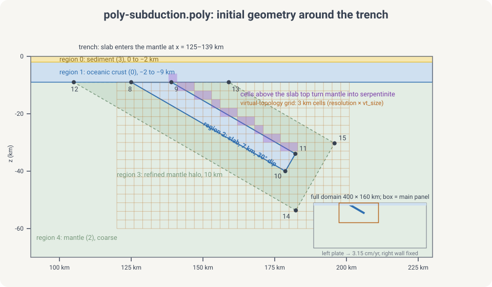
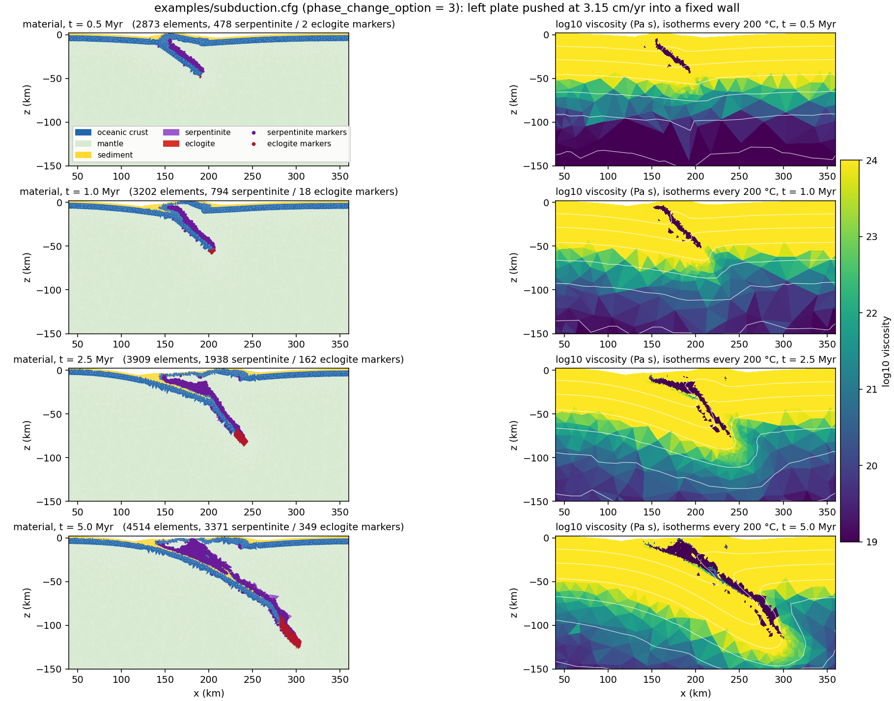

# Tectonic rifting and subduction

This tutorial walks through two classic long-term tectonic models with
DynEarthSol: **rifting** of a brittle crustal layer, which produces a
metamorphic core complex, and **subduction** of an oceanic plate beneath an
overriding plate. Both use bundled 2D examples as a starting point, so you can
run them as they are and then modify one ingredient at a time.

Both cases move material a long way under divergent or convergent forcing.
Deformation localizes where plastic strain accumulates, and with MMG remeshing
the mesh is refined there, so faults stay sharp as the model runs. The first
case takes minutes on a laptop; the second takes hours.

## What you will learn

- How a DES `.cfg` file is organized and which sections matter for tectonics
- How Mohr–Coulomb plasticity with strain softening produces faults
- How to seed deformation with a weak zone and drive it with velocity boundary conditions
- How remeshing keeps a Lagrangian mesh usable, and what MMG adds
- How to build a layered or slab-shaped initial geometry with a `.poly` file
- How to read the output: plastic strain, topography, viscosity, temperature

## Prerequisites

Before starting, ensure you have:

- ✅ DynEarthSol compiled in 2D (`make ndims=2`); see [Build](../usage/usage)
- ✅ Python 3 with `numpy` for `2vtk.py`
- ✅ [ParaView](https://www.paraview.org/) or another VTK viewer
- ✅ Read [Making a complex mesh with `.poly` file](./usingpolyfile) (needed for Part 2)
- ⬜ Optional: MMG, for the adaptive-remeshing boxes; see [Adaptive mesh refinement with MMG](./usingmmg)

:::tip Which build?
The examples in this tutorial are 2D. A 3D build (`make`) runs the same
physics at a much higher cost. Every `.cfg` here runs on a plain Triangle
build; the MMG boxes show what changes when you rebuild with `usemmg = 1`.
:::

## How the model works

DynEarthSol's rheology is built from three responses that can be switched on
per run with `rheology_type`. Part 1 uses `elasto-plastic`; Part 2 adds
viscous creep with `elasto-visco-plastic`.

| Component | Controls | Key parameters | Used in |
|-----------|----------|----------------|---------|
| Elastic | Short-term stress build-up | `bulk_modulus`, `shear_modulus` | Parts 1 and 2 |
| Plastic (Mohr–Coulomb, strain softening) | Brittle faulting | `cohesion0/1`, `friction_angle0/1`, `dilation_angle0/1`, `pls0/1` | Parts 1 and 2 |
| Viscous (power-law creep) | Ductile flow where it is hot | `visc_exponent`, `visc_coefficient`, `visc_activation_energy`, `min_viscosity`, `max_viscosity` | Part 2 only |
| Temperature | Viscosity through creep; density through `alpha` | `temperature_option`, `oceanic_plate_age_in_yr`, `surface_temperature`, `mantle_temperature` | Part 2 only |

### Strain softening

Faults in DES are bands of elements that have yielded. A band localizes only
if the material gets weaker as it deforms: cohesion and friction angle drop
linearly from their `0` values to their `1` values as accumulated plastic
strain goes from `pls0` to `pls1`. Fast softening (small `pls1`) favours one
long-lived fault; slow softening spreads deformation over many short-lived
faults.

{/* TODO: small sketch of cohesion vs plastic strain with pls0/pls1 marked. */}

### Seeding deformation: the weak zone

In a uniform model nothing selects where the first fault forms, so the
location of localization is uncontrolled and depends on mesh noise. A weak
zone is a region given an initial plastic strain `weakzone_plstrain`, which
pre-softens it and pins the first fault. Part 1 uses a planar seed
(`weakzone_option = 1`), Part 2 a dipping multi-segment one. The other shapes
are described in [Weak zones](./weakzone).

### Driving deformation: velocity boundary conditions

`vbc_x0` and `vbc_x1` set the condition type on the left and right walls; type
1 fixes the normal velocity and leaves the shear component free. `vbc_val_x0`
and `vbc_val_x1` are the normal velocities in m/s, positive toward +x, so a
negative value on the left wall and a positive one on the right wall pull the
model apart. The top is a free surface. The bottom carries a Winkler
foundation, a lithostatic normal stress that lets the base move vertically.

### Thermal structure (Part 2)

Part 1 is isothermal. Part 2 sets an initial geotherm by half-space cooling
(`temperature_option = 0`, `oceanic_plate_age_in_yr`), and temperature then
evolves by conduction and advection. It feeds back into the viscosity through
the creep law, which is what makes the deep slab and the mantle wedge flow.

{/* TODO: one sentence each on temperature_option 1-3 for continental geotherms. */}

### Remeshing and markers

A Lagrangian mesh follows the material, so elements distort as faults slip.
When the worst element quality drops below `min_quality` (checked every
`quality_check_step_interval` steps), or a boundary moves by more than
`max_boundary_distortion` × `resolution`, DES rebuilds the mesh and maps the
fields onto it. `remeshing_option = 11` restores the bottom boundary to its
initial depth. Markers carry material identity across remeshes. With MMG the
rebuild is adaptive: elements are sized from accumulated plastic strain, so
faults get finer elements and the quiet far field stays coarse. See
[Remeshing](../theory/remeshing) and [MMG](./usingmmg).

## Part 1: Rifting a brittle crust (core complex)

The bundled example
[`examples/core-complex.cfg`](https://github.com/GeoFLAC/DynEarthSol/blob/master/examples/core-complex.cfg)
stretches a single 10 km brittle layer with a pre-cut dipping fault. With
strain softening the fault keeps slipping, its footwall rises and rotates,
and the fault surface flattens into a dome. This is the rolling-hinge
mechanism of metamorphic core complexes (Lavier, Buck & Poliakov 1999), and
it is the fastest way to see every ingredient of a DES tectonic run.

| | Setting |
|---|---|
| Domain | 100 × 10 km, 1 km resolution refined in the central 40 km (`meshing_option = 2`, `refined_zonex = [0.3, 0.7]`) |
| Forcing | ±1e-9 m/s (3.15 cm/yr per side, 6.3 cm/yr total) extension in x |
| Duration | 50 kyr as shipped (3.2 km of total extension), output every 1.5 kyr |
| Rheology | `elasto-plastic`, one material (ρ = 2700 kg/m³), cohesion 44 → 4 MPa over 0.5 plastic strain, friction 30° fixed |
| Weak zone | Planar (`weakzone_option = 1`), dipping 60°, 1.2 km half-width, in the lower half of the layer at x = 50 km |
| Surface | Hillslope diffusion, `surface_diffusivity = 1e-7` m²/s |
| Thermal | Isothermal, 273 K |

### Step 1: Walk through the configuration

```cfg title="core-complex.cfg"
[sim]
modelname = result3
max_time_in_yr = 50000
output_time_interval_in_yr = 1500
has_output_during_remeshing = no
is_outputting_averaged_fields = no

[mesh]
meshing_option = 2
xlength = 100e3
ylength = 10e3
zlength = 10e3
resolution = 1e3
largest_size = 10
smallest_size = 0.01
refined_zonex = [0.3, 0.7]
refined_zoney = [0.0, 1.0]
refined_zonez = [0.0, 1.0]
quality_check_step_interval = 500
remeshing_option = 11

[control]
surface_process_option = 1
surface_diffusivity = 1e-7
dt_fraction = 1.0
inertial_scaling = 1e5

[bc]
vbc_x0 = 1
vbc_x1 = 1
vbc_val_x0 = -1e-9
vbc_val_x1 = 1e-9
vbc_y0 = 1
vbc_y1 = 1
vbc_val_y0 = 0
vbc_val_y1 = 0
has_water_loading = no
surface_temperature = 273
mantle_temperature = 273

[ic]
weakzone_option = 1
weakzone_azimuth = 15
weakzone_inclination = -60
weakzone_halfwidth = 1.2
weakzone_depth_min = 0.5
weakzone_depth_max = 1.0
weakzone_xcenter = 0.5
weakzone_ycenter = 0.5
weakzone_zcenter = 0
weakzone_plstrain = 0.5

[mat]
rheology_type = elasto-plastic
rho0 = [2700]
alpha = [0]
bulk_modulus = [50e9]
shear_modulus = [30e9]
pls0 = [0]
pls1 = [0.5]
cohesion0 = [4.4e7]
cohesion1 = [4e6]
friction_angle0 = [30]
friction_angle1 = [30]
min_viscosity = 1e24
```

Section by section:

- **`[sim]`** names the output (`result3.save.*`) and runs 50 kyr with a frame
  every 1.5 kyr. Instantaneous rather than averaged fields are written.
- **`[mesh]`** builds a 100 × 10 km box. `meshing_option = 2` refines the
  central 40 % in x at `resolution`, and lets the flanks coarsen up to
  `largest_size` times that. `ylength` is read but unused in 2D.
  `remeshing_option = 11` flattens the bottom back to 10 km depth at every
  remesh.
- **`[control]`** turns on surface diffusion and sets the mass scaling.
  `inertial_scaling` is the factor by which density is inflated to lengthen
  the elastic time step; see [Mass scaling](../theory/massscaling). With no
  viscosity in play, this parameter and the element size set `dt`.
- **`[bc]`** pulls the two walls apart at 3.15 cm/yr each. The `vbc_y*`
  lines matter only in 3D. Water loading is off because the surface starts at
  sea level and would otherwise be loaded as it subsides.
- **`[ic]`** cuts the seed fault. Positions are fractions of the domain:
  `weakzone_xcenter = 0.5` is x = 50 km, and `weakzone_depth_min/max = 0.5, 1.0`
  confines the seed to the lower 5 km. `weakzone_halfwidth` is in units of
  `resolution`. `weakzone_plstrain = 0.5` equals `pls1`, so the seed starts
  fully softened. `weakzone_azimuth` is a 3D parameter and is ignored here.
- **`[mat]`** is one material. Cohesion softens by a factor of 11; friction
  does not. `min_viscosity` is irrelevant for `elasto-plastic` but must be set.

The parameters you will change most often:

| Parameter | What it sets |
|-----------|--------------|
| `max_time_in_yr` | Total extension; 100 kyr gives 6.3 km and a clear dome |
| `weakzone_inclination` | Dip of the seed fault; the sign picks which way it dips |
| `pls1` | Plastic strain needed to fully soften; smaller localizes faster |
| `cohesion1` | Strength after softening; lower = sharper fault |
| `surface_diffusivity` | How fast relief is smoothed; controls footwall exhumation |
| `vbc_val_x0`, `vbc_val_x1` | Extension rate at each wall, m/s |
| `resolution`, `refined_zonex` | Element size and where it is fine |

### Step 2: Run

```bash
cd DynEarthSol/examples
OMP_NUM_THREADS=4 ../dynearthsol2d core-complex.cfg
```

The log prints one line per `output_time_interval_in_yr` with the step count,
model time and `dt`, and a `remeshing` notice whenever the mesh is rebuilt.
Output goes to `result3.save.*` and `result3.info` in the working directory.

Cost on a laptop core: the stock run reaches 50 kyr in a few minutes. To 100
kyr the Triangle build takes about 5.7 million steps and ends with about 2000
elements after some 140 remeshes.

{/* TODO: confirm wall time for the 50 kyr stock run and the 100 kyr run on
    one and four threads; numbers above are from analysis/examples/218 and
    220 at 99 kyr. */}

:::tip MMG: same config, adaptive mesh
Rebuild with `usemmg = 1` and run the same file. The MMG build sizes elements
from accumulated plastic strain, with the band set by two parameters you
already have: the largest edge is `resolution × largest_size^(1/2)` and the
smallest `resolution × (smallest_size × mmg_remesh_defensive_tiny_ratio)^(1/2)`.
In the run shown below MMG reaches 100 kyr with about 1400 elements and 22
remeshes against 2000 elements and 136 remeshes for Triangle. The tuned
variant `core-complex-mmg.cfg` differs from the stock file in these lines:

```cfg
max_time_in_yr = 500000
output_time_interval_in_yr = 10000
largest_size = 4            # MMG hmax = 2 km
smallest_size = 0.04        # MMG hmin = 0.245 km at the default tiny ratio 1.5
quality_check_step_interval = 2000
min_quality = 0.2
max_boundary_distortion = 0.2
mmg_hausd_factor = 0.01
surface_diffusivity = 1e-6
inertial_scaling = 1e4
```

Parameters and the plastic-strain metric are explained in
[Adaptive mesh refinement with MMG](./usingmmg).
:::

### Step 3: Visualize

```bash
python ../2vtk.py result3
```

Open `result3.*.vtu` in ParaView. Fields to look at:

- **plastic strain** — the fault, and whether it stays one band
- **surface topography** — footwall uplift and hanging-wall basin
- **strain rate** — where slip is happening now, as opposed to where it has happened
- **the mesh itself** — how element size tracks the fault after remeshing

{/* TODO: figure from the MMG run — 4 panels of plastic strain on the mesh at
    25, 50, 75, 100 kyr, zoomed to x = 30–70 km, surface drawn. Start from
    analysis/examples/218_core_complex_mmg_ab.py. Save to
    ./img/tectonics/core-complex-plstrain.png

*/}

Things to look for as the run proceeds:

- the seed fault cuts up to the surface within the first few kyr and the
  footwall starts to rise;
- by about 50 kyr the surface has an uplifted footwall near x = 55 km and a
  basin near x = 48 km, about 2 km of relief in total;
- the fault rotates to a shallower dip as it is exhumed; the band of high
  plastic strain curves from steep at depth to gentle near the surface;
- after a remesh the elements along the fault are smaller than in the far
  field if you use MMG, and uniform if you use Triangle.

### Exercise 1: change the dip of the seed fault

| Run | `weakzone_inclination` | What you should see |
|-----|------------------------|---------------------|
| Reference | `-60` | One fault dipping toward −x, footwall on the +x side |
| Shallower | `-45` | {/* TODO: run and describe */} |
| Mirrored | `60` | The same structure mirrored: footwall on the −x side |

A seed closer to the optimal Coulomb dip for 30° friction (about 60°) is
taken up most readily; a seed far from it may be abandoned for a new fault.

### Exercise 2: change the surface diffusivity

| Run | `surface_diffusivity` | What you should see |
|-----|-----------------------|---------------------|
| Reference | `1e-7` | Sharp footwall crest, basin preserved |
| Stock MMG file | `1e-6` | {/* TODO */} |
| Strong erosion | `1e-5` | Footwall planed off as it rises; more exhumation from depth per unit of extension |

Erosion unloads the footwall, which keeps the fault active longer.

### Exercise 3: change the MMG refinement

Requires the MMG build. `mmg_metric_refine_coeff` scales the target element
volume by `1 / (1 + coeff × plastic strain)`.

| Run | `mmg_metric_refine_coeff` | What you should see |
|-----|---------------------------|---------------------|
| No plastic refinement | `0` | Elements stay at their initial size; the shear band is a few elements wide |
| Default | `5` | Band refined toward `smallest_size`; element count grows with the fault |
| Aggressive | `20` | Narrower band, more elements, shorter `dt`, longer run |

Compare the element count and step count in `result3.info` across the three.

Change one parameter at a time, and keep a log of what you changed.

### Going further: a lithospheric rift

`core-complex.cfg` has no mantle, no temperature and no viscosity.
[`examples/rifting-2d.cfg`](https://github.com/GeoFLAC/DynEarthSol/blob/master/examples/rifting-2d.cfg)
adds all three: a 500 × 150 km crust-over-mantle lithosphere read from a
`.poly` file (the one used in [Making a complex mesh](./usingpolyfile)),
`elasto-visco-plastic` rheology, a 100 Myr half-space geotherm and a Gaussian
weak zone. It runs for 2 Myr at 6 km resolution. Everything in Part 2 that
is new relative to Part 1 appears there first, so it is a good intermediate
step.

## Part 2: Subduction

:::caution Part 2 is not finished yet
This part is a skeleton. The subduction example it describes will ship with
an upcoming DynEarthSol release; the settings, configuration excerpts, figures
and exercises below are placeholders until then. Part 1 is complete and runs
on the current release.
:::

{/* TODO: decide which bundled or new example this part uses. Options:
    (a) a new examples/subduction-2d.cfg + .poly to add upstream,
    (b) build it from rifting-2d.poly by adding a slab region.
    Fill the table below once the setup is fixed. */}

| | Setting |
|---|---|
| Domain | {/* TODO */} |
| Materials | {/* TODO: oceanic crust, oceanic mantle lithosphere, continental crust, asthenosphere, weak decoupling layer */} |
| Forcing | {/* TODO: kinematic push on the oceanic side, or free (slab-pull driven) */} |
| Duration | {/* TODO */} |
| Rheology | {/* TODO */} |
| Thermal | {/* TODO: oceanic plate age, continental geotherm */} |

### Step 1: Build the initial geometry

A subducting slab needs a pre-existing dipping interface, which the planar
weak zone of Part 1 cannot provide. Build it with a `.poly` file instead,
following [Making a complex mesh with `.poly` file](./usingpolyfile).

{/* TODO: sketch of the geometry with region numbers; the poly file listing
    (nodes, segments, regions); which region is which material. Save the
    sketch to ./img/tectonics/subduction-geometry.svg */}

{/* TODO: uncomment once the figure exists

*/}

{/* TODO: fill in and uncomment
```poly title="subduction-2d.poly (excerpt)"
```
*/}

### Step 2: Walk through the configuration

{/* TODO: what differs from Part 1 — more materials, mattype_mantle,
    convergent vbc, weak layer along the plate interface, possibly
    phase_change_option, surface processes. */}

{/* TODO: fill in and uncomment
```cfg title="subduction-2d.cfg (excerpt)"
```
*/}

| Parameter | What it sets |
|-----------|--------------|
| {/* TODO */} | |

### Step 3: Run and visualize

```bash
cd DynEarthSol/examples
OMP_NUM_THREADS=4 ../dynearthsol2d subduction-2d.cfg
python ../2vtk.py result
```

{/* TODO: figure — material/marker field and viscosity at several times.
    Save to ./img/tectonics/subduction-evolution.png */}

{/* TODO: uncomment once the figure exists

*/}

Things to look for as the run proceeds:

{/* TODO: slab bending and dip, trench retreat or advance, forearc
    deformation, mantle wedge flow, remeshing events and marker preservation. */}

### Exercise 4: plate interface strength

{/* TODO: vary the weak layer friction angle; too strong → coupling, no
    subduction; too weak → ... */}

### Exercise 5: convergence rate and slab age

{/* TODO */}

## Troubleshooting

{/* TODO: collect real messages as they come up. Candidates below. */}

| Symptom | Part | Cause and fix |
|---------|------|---------------|
| Run stops with a mesh-quality error | both | {/* TODO: lower min_quality, more frequent quality_check_step_interval, or smaller resolution; with MMG, mmg_hausd_factor */} |
| Strain stays diffuse, no single fault | 1 | {/* TODO: pls1 too large or weakzone_plstrain too small */} |
| Fault dies and a new one forms | 1 | {/* TODO: slow softening or thick layer; Lavier et al. 2000 */} |
| Time step collapses (very small `dt`) | 2 | {/* TODO: dt is Maxwell-limited, dt ≈ 0.5 min_viscosity / shear_modulus; raise min_viscosity */} |
| Everything sinks or rises at the start | 2 | {/* TODO: isostasy_adjustment_time_in_yr, reference density, ref_pressure_option */} |
| Slab does not subduct | 2 | {/* TODO: interface too strong, slab too buoyant */} |

## Next Steps

- Copy the example files to start your own model, rather than writing configs from scratch
- Add surface processes with [GoSPL coupling](./couplinggospl)
- Refine the mesh around faults with [MMG](./usingmmg)
- Go to 3D with `oblique-rift-3d.cfg` and `conjugate-faults-3d.cfg`; see
  [Velocity boundary conditions (3D)](./vbc) and [Weak zones](./weakzone)

{/* TODO: add a references bullet — Choi et al. 2013 (DES paper), Lavier,
    Buck & Poliakov 1999 and 2000 (core complex), Tan et al. 2012 (interface
    friction), Hacker 1996, Ulmer & Trommsdorff 1995. */}
