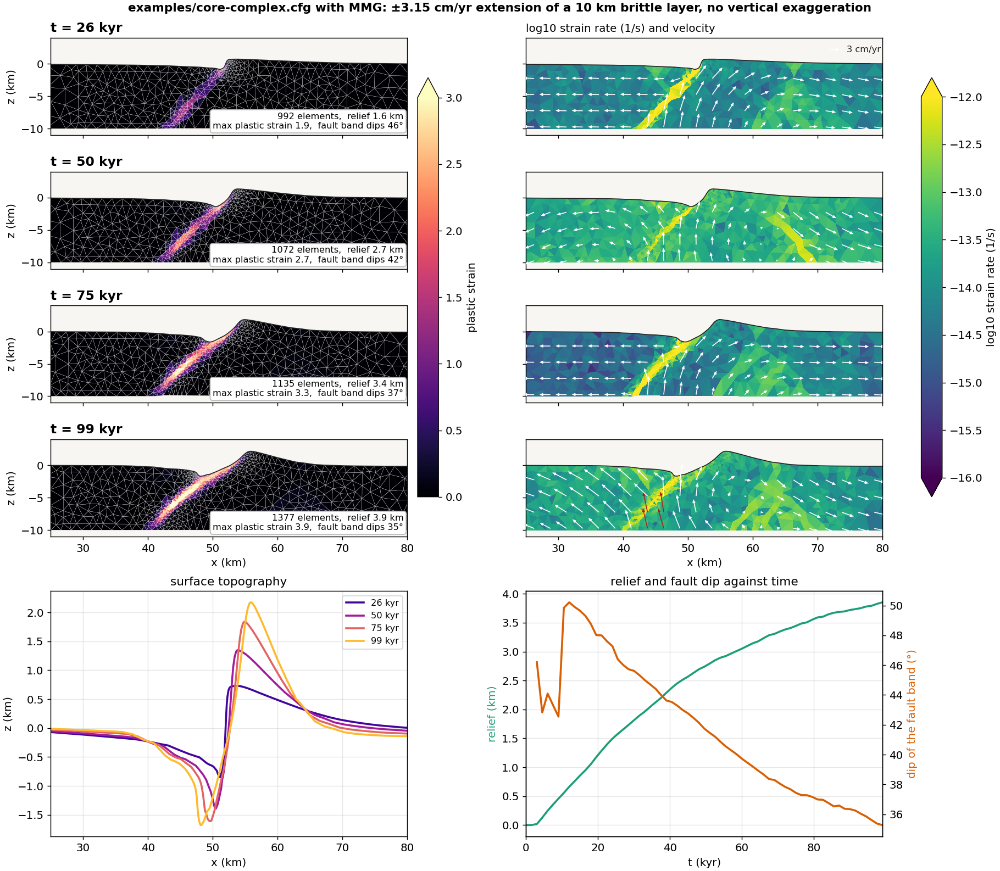
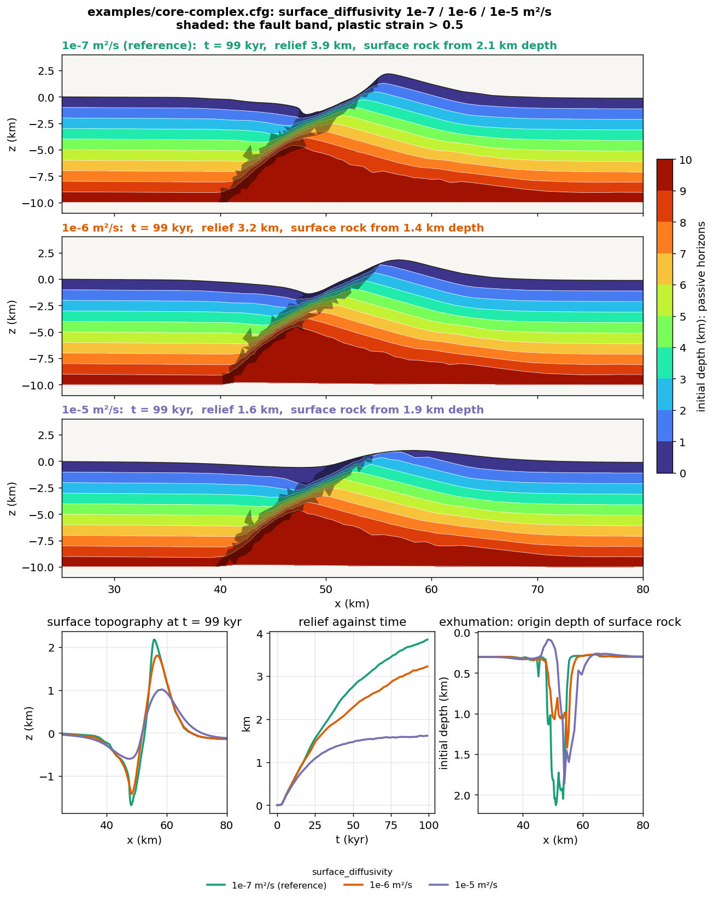
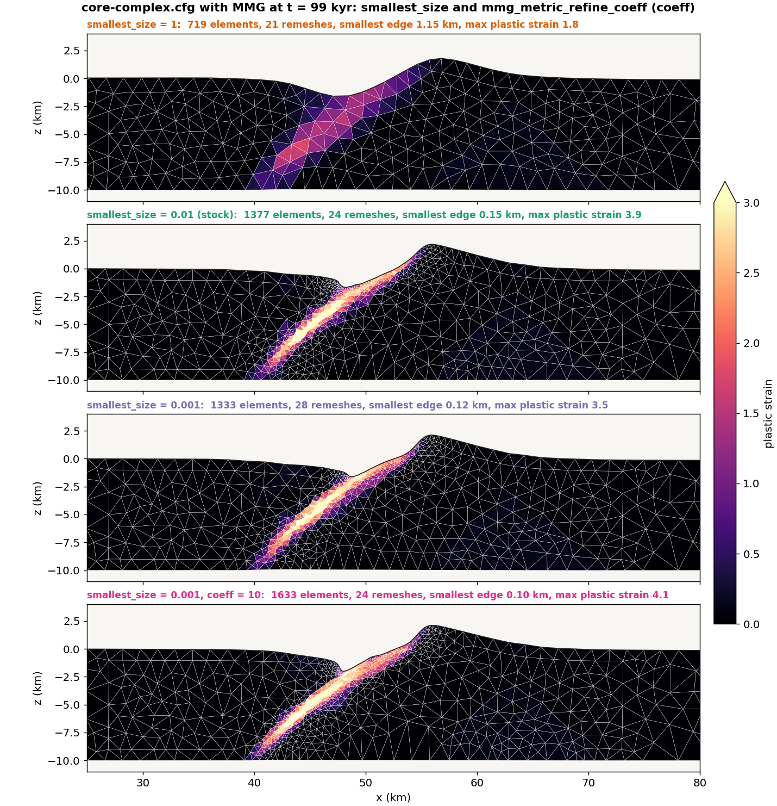
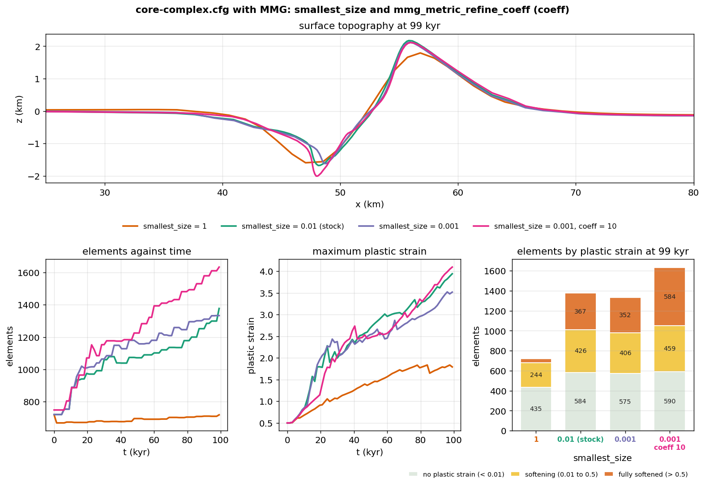

# Tectonic rifting and subduction

This tutorial walks through two classic long-term tectonic models with
DynEarthSol: **rifting** of a brittle crustal layer, which produces a
metamorphic core complex, and **subduction** of an oceanic plate beneath an
overriding plate. Both use bundled 2D examples as a starting point, so you can
run them as they are and then modify one ingredient at a time.

Both cases move material a long way under divergent or convergent forcing.
Deformation localizes where plastic strain accumulates, and with MMG remeshing
the mesh is refined there, so faults stay sharp as the model runs. The first
case takes minutes on a laptop; the second about half an hour.

## What you will learn

- How a DES `.cfg` file is organized and which sections matter for tectonics
- How Mohr–Coulomb plasticity with strain softening produces faults, and how
  a weak zone and the wall velocities decide where and how fast
- How a slab-shaped initial geometry is built with a `.poly` file
- How marker phase changes add serpentinite and eclogite as the slab descends,
  and what the virtual-topology grid does for them
- How remeshing keeps a Lagrangian mesh usable, what triggers it, and how MMG
  refines along the faults and the plate interface
- How to read the output: plastic strain, topography, viscosity, temperature,
  material and velocity
- How to diagnose a run that stops in a remeshing failure and carry it on
  from a checkpoint with a changed parameter

The two parts are meant to be read in order. Part 1 is the smallest model
that shows a DES fault: one material, no temperature, a box mesh, a planar
seed, three run steps. Part 2 keeps that skeleton and adds one ingredient at
a time:

| Ingredient | Part 1: core complex | Part 2: subduction |
|---|---|---|
| Geometry | A box, refined in the middle by the config | A `.poly` file with a slab already in the mantle |
| Materials | One | Six populated, four reserved for phase-change products |
| Rheology | Elasto-plastic | Elasto-visco-plastic with a geotherm |
| Seed | One planar weak zone | One dipping segment along the slab top |
| Walls | Both pulled apart | One pushed in, one fixed; material flows in through the wall |
| Phase changes | None | Serpentinization and eclogitization on a marker grid |
| Remeshing | Bottom restored | Bottom and side walls restored, which needs MMG |
| Run time, 6 threads | 12 minutes to 100 kyr | 23 minutes to 5 Myr |

Each part has the same four steps, geometry, configuration, run, and what to
look for, followed by exercises that change one parameter at a time.

## Prerequisites

This tutorial follows the ones before it in this section and uses what they
cover. Before starting, ensure you have:

- ✅ DynEarthSol compiled in 2D with MMG, `make ndims=2 usemmg=1`; see
  [Build](../usage/usage.md) and [Running DES3D](../usage/run.md). MMG is a
  git submodule that `make` fetches and builds for you; the build is described
  in [Adaptive mesh refinement with MMG](./usingmmg.md)
- ✅ Python 3 with `numpy` for `2vtk.py`, and
  [ParaView](https://www.paraview.org/) or another VTK viewer; see
  [Visualizing outputs](../usage/visualize.md)
- ✅ Read [Making a complex mesh with `.poly` file](./usingpolyfile.md): Part 2
  reads its slab geometry from one
- ✅ Read [Weak zones](./weakzone.md): Part 1 seeds a fault with a planar weak
  zone and Part 2 the plate interface with a segment one

[Velocity boundary conditions (3D)](./vbc.md) and
[Rate-and-state friction](./rate-state-friction.mdx) are not needed here: both
examples are 2D with steady wall velocities and no earthquake cycles. The
next tutorial, [Coupling with GoSPL](./couplinggospl.md), adds surface processes
to models like these.

:::tip Which build?
Both examples are 2D; a 3D build (`make`) runs the same physics at a much
higher cost. Part 1 runs on either build: a plain Triangle build
(`make ndims=2`) remeshes uniformly, an MMG build refines along the fault,
and the MMG box in Part 1 says what changes. Part 2 needs the MMG build,
because its restored side walls (`remeshing_option = 13`) are only available
with MMG. If you build once, build with `usemmg=1`.
:::

## How the model works

DynEarthSol's rheology is built from three responses that can be switched on
per run with `rheology_type`. Part 1 uses `elasto-plastic`; Part 2 adds
viscous creep with `elasto-visco-plastic`.

| Component | Controls | Key parameters | Used in |
|-----------|----------|----------------|---------|
| Elastic | Short-term stress build-up | `bulk_modulus`, `shear_modulus` | Parts 1 and 2 |
| Plastic (Mohr–Coulomb, strain softening) | Brittle faulting | `cohesion0/1`, `friction_angle0/1`, `dilation_angle0/1`, `pls0/1` | Parts 1 and 2 |
| Viscous (power-law creep) | Ductile flow where it is hot | `visc_exponent`, `visc_coefficient`, `visc_activation_energy`, `min_viscosity`, `max_viscosity` | Part 2 only |
| Temperature | Viscosity through creep; density through `alpha` | `temperature_option`, `oceanic_plate_age_in_yr`, `surface_temperature`, `mantle_temperature` | Part 2 only |
| Phase changes | Marker material conversion at pressure–temperature boundaries | `phase_change_option`, `mattype_*`, `has_serpentinization`, `has_eclogitization` | Part 2 only |

### Strain softening

Faults in DES are bands of elements that have yielded. A band localizes only
if the material gets weaker as it deforms: cohesion and friction angle drop
linearly from their `0` values to their `1` values as accumulated plastic
strain goes from `pls0` to `pls1`. Fast softening (small `pls1`) favours one
long-lived fault; slow softening spreads deformation over many short-lived
faults.


### Seeding deformation: the weak zone

In a uniform model nothing selects where the first fault forms, so the
location of localization is uncontrolled and depends on mesh noise. A weak
zone is a region given an initial plastic strain `weakzone_plstrain`, which
pre-softens it and pins the first fault. Part 1 uses a planar seed
(`weakzone_option = 1`), Part 2 a dipping multi-segment one. The other shapes
are described in [Weak zones](./weakzone.md).

### Driving deformation: velocity boundary conditions

`vbc_x0` and `vbc_x1` set the condition type on the left and right walls; type
1 fixes the normal velocity and leaves the shear component free. `vbc_val_x0`
and `vbc_val_x1` are the normal velocities in m/s, positive toward +x, so a
negative value on the left wall and a positive one on the right wall pull the
model apart. The top is a free surface. The bottom carries a Winkler
foundation, a lithostatic normal stress that lets the base move vertically.

### Thermal structure (Part 2)

Part 1 is isothermal. Part 2 sets an initial geotherm by half-space cooling
(`temperature_option = 0`, `oceanic_plate_age_in_yr`), and temperature then
evolves by conduction and advection. It feeds back into the viscosity through
the creep law, which is what makes the deep slab and the mantle wedge flow.
The other options are for continents: 1 is a linear continental gradient
over `lithospheric_thickness`, 2 adds the equilibrium of crustal radiogenic
heating, 3 puts an adiabatic mantle under the continental gradient, and 90
reads a temperature grid from a file.

### Remeshing and markers

A Lagrangian mesh follows the material, so elements distort as faults slip.
When the worst element quality drops below `min_quality` (checked every
`quality_check_step_interval` steps), or a boundary moves by more than
`max_boundary_distortion` × `resolution`, DES rebuilds the mesh and maps the
fields onto it. `remeshing_option = 11` restores the bottom boundary to its
initial depth. Markers carry material identity across remeshes. With MMG the
rebuild is adaptive: elements are sized from accumulated plastic strain, so
faults get finer elements and the quiet far field stays coarse. See
[Remeshing](../theory/remeshing.md) and [MMG](./usingmmg.md).

## Part 1: Rifting a brittle crust (core complex)

The bundled example
[`examples/core-complex.cfg`](https://github.com/GeoFLAC/DynEarthSol/blob/master/examples/core-complex.cfg)
stretches a single 10 km brittle layer with a pre-cut dipping fault. With
strain softening the fault keeps slipping, its footwall rises and rotates,
and the fault surface flattens into a dome. This is the rolling-hinge
mechanism of metamorphic core complexes (Lavier, Buck & Poliakov 1999), and
it is the fastest way to see every ingredient of a DES tectonic run.


| | Setting |
|---|---|
| Domain | 100 × 10 km, 1 km resolution refined in the central 40 km (`meshing_option = 2`, `refined_zonex = [0.3, 0.7]`) |
| Forcing | ±1e-9 m/s (3.15 cm/yr per side, 6.3 cm/yr total) extension in x |
| Duration | 50 kyr as shipped (3.2 km of total extension), output every 1.5 kyr |
| Rheology | `elasto-plastic`, one material (ρ = 2700 kg/m³), cohesion 44 → 4 MPa over 0.5 plastic strain, friction 30° fixed |
| Weak zone | Planar (`weakzone_option = 1`), dipping 60°, 1.2 km half-width, in the lower half of the layer at x = 50 km |
| Surface | Hillslope diffusion, `surface_diffusivity = 1e-7` m²/s |
| Thermal | Isothermal, 273 K |

### Step 1: The initial geometry and mesh

Part 1 needs no mesh file. The box, its refinement and the seed fault are all
set in the config: `meshing_option = 2` meshes a rectangle at `resolution`
between `refined_zonex = [0.3, 0.7]`, 30 to 70 km, and lets elements grow to
`largest_size` times the area outside, about 3 km on an edge. The seed is a
planar weak zone through (50 km, 0) dipping 60° toward −x, 1.2 km wide and
confined to the lower half of the layer, where it is given a plastic strain
equal to `pls1` so it starts fully softened.


### Step 2: The configuration

```cfg title="core-complex.cfg"
[sim]
modelname = result3
max_time_in_yr = 50000
output_time_interval_in_yr = 1500
has_output_during_remeshing = no
is_outputting_averaged_fields = no

[mesh]
meshing_option = 2
xlength = 100e3
ylength = 10e3
zlength = 10e3
resolution = 1e3
largest_size = 10
smallest_size = 0.01
refined_zonex = [0.3, 0.7]
refined_zoney = [0.0, 1.0]
refined_zonez = [0.0, 1.0]
quality_check_step_interval = 500
remeshing_option = 11

[control]
surface_process_option = 1
surface_diffusivity = 1e-7
dt_fraction = 1.0
inertial_scaling = 1e5

[bc]
vbc_x0 = 1
vbc_x1 = 1
vbc_val_x0 = -1e-9
vbc_val_x1 = 1e-9
vbc_y0 = 1
vbc_y1 = 1
vbc_val_y0 = 0
vbc_val_y1 = 0
has_water_loading = no
surface_temperature = 273
mantle_temperature = 273

[ic]
weakzone_option = 1
weakzone_azimuth = 15
weakzone_inclination = -60
weakzone_halfwidth = 1.2
weakzone_depth_min = 0.5
weakzone_depth_max = 1.0
weakzone_xcenter = 0.5
weakzone_ycenter = 0.5
weakzone_zcenter = 0
weakzone_plstrain = 0.5

[mat]
rheology_type = elasto-plastic
rho0 = [2700]
alpha = [0]
bulk_modulus = [50e9]
shear_modulus = [30e9]
pls0 = [0]
pls1 = [0.5]
cohesion0 = [4.4e7]
cohesion1 = [4e6]
friction_angle0 = [30]
friction_angle1 = [30]
min_viscosity = 1e24
```

Section by section:

- **`[sim]`** names the output (`result3.save.*`) and runs 50 kyr with a frame
  every 1.5 kyr. Instantaneous rather than averaged fields are written.
- **`[mesh]`** builds a 100 × 10 km box. `meshing_option = 2` refines the
  central 40 % in x at `resolution`, and lets the flanks coarsen up to
  `largest_size` times that. `ylength` is read but unused in 2D.
  `remeshing_option = 11` flattens the bottom back to 10 km depth at every
  remesh.
- **`[control]`** turns on surface diffusion and sets the mass scaling.
  `inertial_scaling` is the factor by which density is inflated to lengthen
  the elastic time step; see [Mass scaling](../theory/massscaling.md). With no
  viscosity in play, this parameter and the element size set `dt`.
- **`[bc]`** pulls the two walls apart at 3.15 cm/yr each. The `vbc_y*`
  lines matter only in 3D. Water loading is off because the surface starts at
  sea level and would otherwise be loaded as it subsides.
- **`[ic]`** cuts the seed fault. Positions are fractions of the domain:
  `weakzone_xcenter = 0.5` is x = 50 km, and `weakzone_depth_min/max = 0.5, 1.0`
  confines the seed to the lower 5 km. `weakzone_halfwidth` is in units of
  `resolution`. `weakzone_plstrain = 0.5` equals `pls1`, so the seed starts
  fully softened. `weakzone_azimuth` is a 3D parameter and is ignored here.
- **`[mat]`** is one material. Cohesion softens by a factor of 11; friction
  does not. `min_viscosity` is irrelevant for `elasto-plastic` but must be set.

The parameters you will change most often:

| Parameter | What it sets |
|-----------|--------------|
| `max_time_in_yr` | Total extension; 100 kyr gives 6.3 km and a clear dome |
| `weakzone_inclination` | Dip of the seed fault; the sign picks which way it dips |
| `pls1` | Plastic strain needed to fully soften; smaller localizes faster |
| `cohesion1` | Strength after softening; lower = sharper fault |
| `surface_diffusivity` | How fast relief is smoothed; controls footwall exhumation |
| `vbc_val_x0`, `vbc_val_x1` | Extension rate at each wall, m/s |
| `resolution`, `refined_zonex` | Element size and where it is fine |

### Step 3: Run

```bash
cd DynEarthSol/examples
OMP_NUM_THREADS=6 ../dynearthsol2d core-complex.cfg
```

As shipped the file stops at 50 kyr, which is enough to see the fault break
through and the footwall start to rise. The figures below run to 100 kyr,
when the dome is fully formed; to reproduce them, change one line:

```cfg
max_time_in_yr = 100000
```

The log prints one line per `output_time_interval_in_yr` with the step count,
model time and `dt`, and a `remeshing` notice whenever the mesh is rebuilt.
Output goes to `result3.save.*` and `result3.info` in the working directory.

Cost on a laptop: the stock 50 kyr run takes a few minutes. To 100 kyr the
MMG build took 12 minutes on 6 threads while another run shared the machine,
7.0 million steps, 24 remeshes, 720 to about 1400 elements. The Triangle build
needs about the same number of steps but ends with about 2000 elements after
some 140 remeshes. Remeshing is under 0.1 % of the wall time either way; the
time step, not the mesh, is the cost.

:::tip With and without MMG
The runs shown below use the MMG build from the prerequisites. The same file
also runs on a plain Triangle build (`make ndims=2`); nothing in the config
changes. The difference is in how the mesh is rebuilt. MMG sizes elements
from accumulated plastic strain, within a band set by two parameters the file
already has: the largest edge is `resolution × largest_size^(1/2)` and the
smallest `resolution × (smallest_size × mmg_remesh_defensive_tiny_ratio)^(1/2)`,
3.2 km and 0.12 km here, and it is conservative, freezing elements that are
not yielding, distorted or tiny so that each remesh touches mainly the fault
band. Triangle rebuilds the whole mesh at the initial sizes. To 100 kyr the
MMG run ends with about 1400 elements after 24 remeshes, the Triangle run
with about 2000 after some 140.

The build is described in [Adaptive mesh refinement with MMG](./usingmmg.md).
The full parameter list, with a one-line tuning rule for each, is in the
`[mesh]` section of
[`examples/defaults.cfg`](https://github.com/GeoFLAC/DynEarthSol/blob/master/examples/defaults.cfg)
and in `dynearthsol2d --help`. These parameters are in DynEarthSol `master`
since [PR #95](https://github.com/GeoFLAC/DynEarthSol/pull/95), October 2026.
:::

### Step 4: What to look for

```bash
python ../2vtk.py result3
```

Open `result3.*.vtu` in ParaView. Fields to look at:

- **plastic strain**, the fault, and whether it stays one band
- **surface topography**, footwall uplift and hanging-wall basin
- **strain rate**, where slip is happening now, as opposed to where it has happened
- **the mesh itself**, how element size tracks the fault after remeshing



The left column is where slip has accumulated and how the mesh follows it;
the right column is where slip is happening now. They differ: at 50 kyr the
strain rate shows a second, antithetic band under the footwall at x = 60–70
km that never gains enough plastic strain to show on the left. The bottom
row quantifies the rolling hinge: the fault band steepens to 50° while it
breaks through, then rotates steadily to 35° by 100 kyr as relief grows to
3.9 km.

Things to look for as the run proceeds (the figure is the reference run):

- **Breakthrough.** The seed fault cuts up to the surface within the first
  10 kyr and the footwall starts to rise; the velocity arrows show the
  footwall moving up and to the right while the hanging wall slides left.
- **Relief.** By 50 kyr the surface has a footwall crest of 1.3 km near
  x = 54 km and a basin of 1.4 km near x = 50 km, 2.7 km of relief; by
  100 kyr the crest is 2.2 km at x = 56 km and the relief 3.9 km.
- **The rolling hinge.** The fault rotates to a shallower dip as it is
  exhumed, from about 46° at 25 kyr to 35° at 100 kyr; the band of high
  plastic strain curves from steep at depth to gentle near the surface, and
  its exhumed upper part drapes the footwall dome.
- **The mesh.** After a remesh the elements along the fault are smaller than
  in the far field with MMG, and uniform with Triangle; the MMG run grows
  from 720 to about 1400 elements over 100 kyr.

### Exercise 1: change the surface diffusivity

| Run | `surface_diffusivity` | What you should see at 100 kyr |
|-----|-----------------------|-------------------------------|
| Reference | `1e-7` | Sharp footwall crest 2.2 km high, basin 1.7 km deep, 3.9 km of relief |
| Moderate | `1e-6` | The same structure a little smoothed: crest 1.8 km, basin 1.4 km, 3.2 km of relief |
| Strong erosion | `1e-5` | Relief capped at 1.6 km from 40 kyr on; the crest is planed to 1 km and the basin filled to 0.6 km while the fault keeps slipping |



The coloured bands are passive horizons: every node carries its initial
position through remeshing in the `coord0` field, so contouring the initial
depth on the present mesh shows where each layer of the original crust has
gone. Read them together with the surface panels:

- **The fault is the same in all three runs.** The band dips 42° at 50 kyr
  and 35° at 100 kyr and reaches a plastic strain of 3.9 whatever the
  diffusivity. Diffusion acts on the surface only.
- **So is the exhumation.** Rock from 8 km depth has risen to 3.9 km below the
  surface at x = 48 km in all three, the horizons under the dome are bent
  the same way, and the rock exposed at the surface came from 1.4 to 2.1 km in
  every run. The fault sets how far the footwall rises; erosion does not add
  to it here.
- **What changes is the topography.** At 1e-5 m²/s the relief stops growing
  at 40 kyr because the crest is planed as fast as the fault lifts it and
  the debris fills the basin. The same exhumation then shows as a low dome
  rather than a sharp crest.

That is why relief alone is a poor measure of what a fault has done, and why
the horizons are worth drawing. Each run took 5 to 12 minutes on 6 threads.

### Exercise 2: change how small the elements may get

Requires the MMG build (`make ndims=2 usemmg=1`). Two parameters decide how
fine the mesh becomes along the fault. `smallest_size` is the area of the
smallest allowed element relative to one of edge `resolution`: with MMG it
sets the floor of the refinement band,
`resolution × (smallest_size × mmg_remesh_defensive_tiny_ratio)^(1/2)`, and
for every remesher it sets the tiny-element trigger, an element compressed
below `smallest_size` of its nominal area forcing a remesh. Both scale with
its square root, so a factor of 100 in `smallest_size` is a factor of 10 in
element edge. `mmg_metric_refine_coeff` is the target: MMG aims for an
element area of the initial one divided by `1 + coeff × plastic strain`, so
at the default 5 an element at a plastic strain of 4 is asked to shrink to a
fifth of its initial edge. The mesh can only be as fine as the target asks
and the floor allows.

| Run | `smallest_size` | Smallest MMG element | What you should see |
|-----|-----------------|----------------------|---------------------|
| No refinement | `1` | 1.2 km | A diffuse band 3 km wide that never sharpens; the run takes a tenth of the time |
| Stock | `0.01` | 0.12 km | A sharp fault, about 1400 elements; 12 min |
| Very fine | `0.001` | 0.04 km | The same mesh as stock, since the target rather than the floor limits refinement; 60 % more steps for nothing |
| Very fine, stronger target | `0.001` with `mmg_metric_refine_coeff = 10` | 0.04 km | Now the band refines: 1630 elements, half again as many in the band |



All four rows were run. Going up to `smallest_size = 1` costs resolution:
the fault still forms in the same place and the surface still domes, but
the band cannot be narrower than the elements it runs through, so the strain
is spread over a 3 km wide zone and the fault never sharpens. The time step
is seven times longer, since it follows the smallest element, and the whole
run takes a tenth of the time.

Going down to `0.001` alone buys nothing. The smallest element in the stock
run is 0.15 km, above the 0.12 km floor, so the floor was not what stopped
the refinement; the target was. Lowering the floor further cannot refine the
band, and what it does change is the tiny-element trigger: squeezed elements
may now shrink to a third of the size before a remesh repairs them, so the
time step falls and the run needs 60 % more steps for the same result.

Raising the target as well, `mmg_metric_refine_coeff = 10`, is what makes
the lower floor useful. The band now holds 580 elements instead of 350, at a
median edge of 0.29 km instead of 0.38, and the smallest element reaches
0.10 km, still above the 0.04 km floor. The fault is drawn more sharply and
the maximum plastic strain is a little higher, 4.1 against 3.9.



The surface itself hardly notices: the three refined runs end with the same crest and
basin to within 0.2 km, and only the unrefined run is lower and broader. The
lesson is that the two parameters work as a pair: the target asks for refinement
where plastic strain accumulates, the floor caps how far it may go, and
moving one without the other changes the cost of the run more than its
result.

Change one parameter at a time, and keep a log of what you changed.

### Going further: a lithospheric rift

`core-complex.cfg` has no mantle, no temperature and no viscosity.
[`examples/rifting-2d.cfg`](https://github.com/GeoFLAC/DynEarthSol/blob/master/examples/rifting-2d.cfg)
adds all three: a 500 × 150 km crust-over-mantle lithosphere read from a
`.poly` file (the one used in [Making a complex mesh](./usingpolyfile.md)),
`elasto-visco-plastic` rheology, a 100 Myr half-space geotherm and a Gaussian
weak zone. It runs for 2 Myr at 6 km resolution. Everything in Part 2 that
is new relative to Part 1 appears there first, so it is a good intermediate
step.

## Part 2: Subduction

:::caution Part 2 runs on code under review
The example below, `examples/subduction.cfg`, and the phase-change engine it
uses (`phase_change_option = 3` on a virtual-topology marker grid) are
DynEarthSol [pull request #110](https://github.com/GeoFLAC/DynEarthSol/pull/110),
open against `master` from the branch `feature/virtual-topology`. Until it
merges, build from that branch. Parameter names could still change in review.
:::

The example
[`examples/subduction.cfg`](https://github.com/GeoFLAC/DynEarthSol/blob/feature/virtual-topology/examples/subduction.cfg)
with its mesh file `poly-subduction.poly` pushes an oceanic plate under a
fixed overriding plate. A short slab is already in the mantle at the start,
so the plate interface exists from the first step. Two metamorphic reactions
run on the markers as the slab descends: mantle just above the slab top
becomes **serpentinite**, a weak and light layer that lubricates the
interface, and slab crust that sinks past the basalt-to-eclogite boundary
becomes **eclogite**, dense enough to add slab pull. Everything that was
missing from Part 1 appears here: several materials, viscous creep, a
geotherm, a `.poly` geometry, phase changes and material flowing in through
a side wall.

| | Setting |
|---|---|
| Domain | 400 × 160 km, 6 km resolution, a 10 km halo of refined mantle around the slab (`poly-subduction.poly`) |
| Initial slab | Oceanic crust 7 km thick, from the trench at x = 125–139 km dipping 30° to 40 km depth |
| Forcing | Left plate pushed at +1e-9 m/s (3.15 cm/yr) into a fixed right wall (`vbc_val_x1 = 0`) |
| Duration | 5 Myr, a frame every 50 kyr; about 23 min alone on 6 threads, 31 min when two runs share the machine; 5.8 million steps |
| Rheology | `elasto-visco-plastic`, 10 materials of which 6 are populated; cohesion 40 → 4 MPa and friction 30° → 15° over 0.1 plastic strain; sediment and serpentinite at 3° |
| Phase changes | `phase_change_option = 3`: serpentinization and eclogitization on, the other rules off |
| Weak zone | One 30° segment along the slab top (`weakzone_option = 5`), seeding the plate interface |
| Thermal | Half-space cooling, 80 Myr plate; surface 273 K, mantle 1573 K |
| Remeshing | MMG required; `remeshing_option = 13` restores the side walls so the incoming plate keeps its layering |
| Surface | Hillslope diffusion, `surface_diffusivity = 5e-7` m²/s; deposits become sediment |

### Step 1: The initial geometry and mesh

A subducting slab needs a pre-existing dipping interface, which a weak zone
alone cannot supply. `poly-subduction.poly` defines it as a region of oceanic
crust already inside the mantle, following
[Making a complex mesh with `.poly` file](./usingpolyfile.md):

```
 0------------------------------------------7  z = 0: top, free surface
 1------------------------------------------6  z = -2 km: sediment / crust
 2----12--8=====9--13-----------------------5  z = -9 km: crust / mantle
 |      \  \  0  \   \                      |
 |       \  10----11   15                   |  10-11: slab end, cut normal to the dip
 |        \         \ /                     |  12-14: halo below the slab
 |         14-------/                       |  13-15: halo above the slab
 |                                          |
 3------------------------------------------4  z = -160 km: bottom
```

| Region | Material | Max element area | What it is |
|---|---|---|---|
| 0 | 3, sediment | 4 km² | The top 2 km across the whole domain |
| 1 | 0, oceanic crust | 8 km² | 2 to 9 km depth across the whole domain |
| 2 | 0, oceanic crust | 8 km² | The slab, 7 km thick, 30° dip, ending at 34–40 km depth |
| 3 | 2, mantle | 10 km² | A 10 km halo around the slab, refined so the serpentinite layer is resolved |
| 4 | 2, mantle | 1000 km² | The rest of the mantle, coarse |

Three things to notice:

- No region holds serpentinite or eclogite. Those materials exist only
  because the phase-change rules create them.
- The halo is what makes the example affordable: 6 km elements everywhere
  except a band where the interface needs them finer.
- The internal segments are discarded at the first remesh
  (`is_discarding_internal_segments = yes`). After that the slab is carried
  by the markers alone, which is why `has_marker_output = yes` is set.


The grid drawn over the slab is the virtual topology used by the
serpentinization rule, explained [below](#the-phase-change-rules). Its cells
are half an element wide, so the one-element-thick slab crust gets its own
row of crust-dominant cells instead of being averaged with the mantle.

### Step 2: The configuration

```cfg title="subduction.cfg (abridged; the file itself is fully commented)"
[sim]
modelname = model-subduction
max_time_in_yr = 5e6
output_time_interval_in_yr = 50e3
has_marker_output = yes

[mesh]
meshing_option = 90
poly_filename = poly-subduction.poly
xlength = 400e3
zlength = 160e3
resolution = 6e3            # times vt_size = serpentinization grid cell
smallest_size = 0.04
quality_check_step_interval = 1000
min_quality = 0.2
remeshing_option = 13       # restore the side walls (needs MMG)
is_discarding_internal_segments = yes
mmg_hausd_factor = 0.1
max_boundary_distortion = 1
mmg_aniso_wall_ratio = 2

[markers]
init_marker_option = 1
replenishment_option = 12

[control]
ref_pressure_option = 1     # PREM
surface_process_option = 1
surface_diffusivity = 5e-7
inertial_scaling = 1e4

[bc]
surface_temperature = 273
mantle_temperature = 1573
vbc_x0 = 1
vbc_x1 = 1
vbc_val_x0 = 1e-9           # +x, 3.15 cm/yr
vbc_val_x1 = 0              # fixed backstop
has_water_loading = no

[ic]
weakzone_option = 5
weakzone_plstrain = 1
weakzone_num_segments = 1
weakzone_segments_inclination = [30]
weakzone_segments_halfwidth   = [0.6]
weakzone_segments_xcenter     = [0.42]
weakzone_segments_zcenter     = [0.135625]
weakzone_segments_depth_min   = [0.000]
weakzone_segments_depth_max   = [0.19375]
weakzone_segments_x_min       = [0.275]
weakzone_segments_x_max       = [0.575]
oceanic_plate_age_in_yr = 80e6

[mat]
rheology_type = elasto-visco-plastic
num_materials = 10
phase_change_option = 3
mattype_oceanic_crust = 0
mattype_continental_crust = 1
mattype_mantle = 2
mattype_sediment = 3
mattype_serpentinite = 4
mattype_eclogite = 5
serpentinization_thickness = 5e3
#                 [ ocean0   cont1    mant2   sed3    serp4   eclg5  ... ]
rho0            = [ 2880,    2800,    3300,   2400,   3200,   3480,  ... ]
friction_angle0 = [ 30,      30,      30,     3,      3,      30,    ... ]
friction_angle1 = [ 15,      15,      15,     3,      3,      15,    ... ]
pls1            = [ 0.1 ]
max_viscosity = 1e24
min_viscosity = 1e19
```

Section by section, with what is new relative to Part 1:

- **`[sim]`** writes a frame every 50 kyr and the markers with it, since the
  materials live on the markers once the poly segments are gone.
- **`[mesh]`** reads the `.poly` file (`meshing_option = 90`).
  `remeshing_option = 13` restores the left and right walls to their initial
  positions at every remesh, so the plate entering through the left wall
  arrives with its sediment-over-crust-over-mantle layering intact. This
  option needs MMG. `mmg_aniso_wall_ratio = 2` lets the incoming column be
  carried on elements twice as long normal to the wall as along it.
- **`[markers]`** `replenishment_option = 12` refills an element that has
  lost its markers with its own single material, which keeps thin layers
  from vanishing.
- **`[control]`** `ref_pressure_option = 1` uses the PREM reference
  pressure; the phase-change rules read pressure and temperature at the
  marker's depth below the current free surface. `inertial_scaling = 1e4`
  lengthens the time step ten times over the default, buying speed at a
  known cost in accuracy, which the file's comments quantify.
- **`[bc]`** pushes only the left wall. The right wall is a fixed backstop,
  so the trench sits still in the model frame and the slab is fed from the
  left. The two temperatures set the half-space geotherm with the 80 Myr
  age in `[ic]`.
- **`[ic]`** seeds the interface with a single 30° plastic weak zone along
  the slab top, extending a few km into the mantle wedge. Values are
  fractions of the domain.
- **`[mat]`** has ten material slots. Six are populated by the initial mesh
  or the active rules: oceanic crust, continental crust (unused here),
  mantle, sediment, serpentinite and eclogite. Four more, hydrous mantle,
  sedimentary rock, metasediment and schist, are the targets of rules that
  are switched off, so they stay empty. Each `mattype_*` tells the rule
  engine which slot plays which role.

#### The phase-change rules

`phase_change_option = 3` runs every 10 steps over all markers. A rule fires
only when its switch is on and its source and target are distinct, valid
materials; the run stops at input otherwise.

| Transition | Rule | Switch |
|---|---|---|
| Mantle → serpentinite | In the antigorite pressure–temperature field (Ulmer & Trommsdorff 1995), shallower than 150 km, and with a grid cell within `serpentinization_thickness` below the marker that is more than half oceanic crust or sediment | `has_serpentinization` (on) |
| Serpentinite → mantle | Above 550 °C and outside the antigorite field | `has_serpentinization` (on) |
| Oceanic crust → eclogite | Past the basalt–eclogite boundary (Hacker 2003); one way | `has_eclogitization` (on) |
| Hydrous mantle → mantle | Chlorite-out boundary (Grove et al. 2009) | `has_hydrous_mantle_dehydration` (off) |
| Sediment → sedimentary rock → metasediment → schist | Compaction, then metamorphic thresholds | `has_sediment_metamorphism` (off) |

The "crust below" test is what makes serpentinization follow the slab
instead of the whole mantle. DES keeps a coarse background grid of marker
materials, the **virtual topology**, with cells of `resolution × vt_size`
(3 km here). A mantle marker looks down through that grid as far as
`serpentinization_thickness`, 5 km here, so one cell, and converts if it
finds a cell that is mostly crust. The grid is built at the start, rebuilt
after each remesh and carried through checkpoints, so a restart continues
with the same cells. Two details worth knowing: the reach is counted in
whole cells, so it can differ from the nominal thickness by up to two
cells; and the pressure the rules read is the element mean stress, not a
fixed lithostat, so tectonic over- and underpressure shift the reaction
boundaries slightly.

The parameters you will change most often:

| Parameter | What it sets |
|-----------|--------------|
| `vbc_val_x0` | Convergence rate, m/s |
| `oceanic_plate_age_in_yr` | Thermal age, hence strength and negative buoyancy, of the incoming plate |
| `friction_angle0/1` of sediment and serpentinite | Plate-interface strength; controls dip and forearc style |
| `serpentinization_thickness` | How thick the weak layer above the slab can grow, in whole grid cells; must be positive and at least one cell, so "none" is `has_serpentinization = no` |
| `has_serpentinization`, `has_eclogitization` | Turn each reaction off for a control run |
| `rho0` of eclogite | Slab pull at depth |
| `surface_diffusivity` | Trench fill and forearc erosion |
| `max_time_in_yr` | 5 Myr is about 160 km of convergence |

### Step 3: Run

Run from `examples/` so the `.poly` path resolves. The MMG build from the
prerequisites is required here, since the restored side walls need it:

```bash
cd DynEarthSol/examples
OMP_NUM_THREADS=6 ../dynearthsol2d subduction.cfg
```

The full run takes about 23 minutes on 6 threads of a recent laptop, two to
three times that on an older 4-core machine, with the mesh growing from
about 2600 to 4500 elements. Output goes to `model-subduction.save.*`; the
step counter in the log advances about a million steps per 0.9 Myr.

:::tip Smoke run first
Before committing to the full run, set `max_time_in_yr = 500e3` and
`output_time_interval_in_yr = 25e3`. That is 2 to 3 minutes on 6 threads and
already shows the serpentinite layer along the slab top and a sediment-filled
trench, enough to confirm the build, the MMG remeshing and the phase changes
all work. Then restore the two lines.
:::

### Step 4: What to look for

```bash
python ../2vtk.py model-subduction
```

Open `model-subduction.*.vtu` in ParaView. Fields to look at:

- **material** on the markers, to see serpentinite and eclogite appear
- **plastic strain**, the plate interface and any forearc faults
- **viscosity**, the cold slab against the weak wedge
- **temperature**, the slab's thermal anomaly and the heated wedge corner


Things to look for as the run proceeds (the figure is the reference run):

- **Serpentinite from the first frame.** The slab is already in place, so
  mantle just above its top converts at once: about 450 markers by 0.5 Myr,
  3100 by 5 Myr. On the viscosity panels this layer sits at the 10¹⁹ Pa s
  floor and is the weakest material in the model.
- **Eclogite starts at the slab tip.** A few dozen markers have converted by
  0.5 Myr, where the tip sits near 50 km; the count grows to about 400 by
  5 Myr, when the deepest 30 km of the slab is eclogite.
- **The slab tip** reaches 50 km at 0.5 Myr, 90 km at 2.5 Myr and about 125
  km at 5 Myr, keeping a dip of 30–35° on its way down. The cold core stays
  at the 10²⁴ Pa s viscosity cap and drags the isotherms down with it.
- **The wedge corner serpentinizes wholesale.** The mantle between the
  overriding plate's crust and the slab top lies within one grid cell of
  crust, so by 2.5 Myr a body 20–25 km thick and 50 km long has converted.
  This is the geometric rule at work, not a thermal one; Exercise 3 shows
  how `serpentinization_thickness` controls it.
- **The trench** fills with sediment and the overriding plate's crust bends
  down into it, while the incoming plate at the left wall keeps its three
  layers thanks to the restored wall.

{/* Numbers are from the PR #110 head run pr110-ref (analysis/examples/376). */}

#### How the mesh keeps up


The mesh nearly doubles over the run, and the left panel shows where the
new elements go. Elements with no plastic strain fall from 2600 to about
1900 as the deforming band widens into them, and they stay coarse at a
median of 4.7 km. Fully softened elements, those past `pls1 = 0.1`, grow from
none to about 2100, 44 % of the mesh, at a median size of 2.0 km against the
6 km resolution and the 1.5 km MMG floor. That is the MMG metric at work:
`mmg_metric_refine_coeff` shrinks the target size where plastic strain has
accumulated, along the plate interface and in the wedge, and nowhere else.

The 206 remeshes have three triggers, each checked every
`quality_check_step_interval` steps. A **tiny element** is one whose area has
dropped below `smallest_size` times the resolution squared. **Low quality** is
an element quality below `min_quality`, 0.2 here. **Bottom drift** is a bottom
node more than `max_boundary_distortion` times `resolution`, 6 km here, from
the 160 km base. The first two are the ordinary triggers and fire throughout.
Bottom drift dominates the first 2 Myr while the slab tip sinks through the
lower mantle and the Winkler bottom adjusts, then fades. Each remesh moves
the element count by only a few tens, because the conservative MMG mode
freezes elements that are not yielding, distorted or tiny. Remeshing takes
under 1 % of the wall time; the phase changes take 4 %.

### Exercise 3: change the thickness of the serpentinite layer

`serpentinization_thickness` sets how far above the slab top mantle can
convert, counted in 3 km grid cells. It must be positive, so the zero case
is the rule switched off.

| Run | Thickness | Change | What you should see |
|-----|-----------|--------|---------------------|
| None | 0 km | `has_serpentinization = no` | The interface locks. The slab tip stalls near 80 km from 2 Myr on and the slab necks off; both plates thicken and buckle, relief reaches ±7 km, and the run ends at 3.45 Myr in a remeshing failure at the inflow wall (see the troubleshooting case below) |
| Reference | 5 km | `serpentinization_thickness = 5e3` (one cell) | Steady subduction to 125 km at 5 Myr; trench 6 km deep at 2 Myr, recovering to 4 km; about 3100 serpentinite and 400 eclogite markers |
| Thick | 10 km | `serpentinization_thickness = 10e3` (two cells) | Half again as much serpentinite (4600 markers) in a wedge body that reaches further down the slab; trench 1.5 km shallower throughout; slab tip 120 km; 40 % fewer eclogite markers |


What the comparison shows:

- **The weak layer is what makes this model subduct.** Without it the
  sediment seed alone cannot keep the interface slipping; convergence goes
  into thickening and buckling the plates, the slab stops descending and tears
  below the overriding plate, and the mesh at the thickened inflow wall
  eventually defeats the remesher. The failure message, `[DES exit 41] mesh
  generation` after an MMG normal-vector error, is the symptom, not the cause.
- **A thicker layer lubricates more.** With two cells the trench is shallower
  by about 1.5 km for the whole run, the forearc high is lower, and the
  wedge-corner body is larger. The slab tip ends 6 km shallower.
- **Eclogite responds indirectly.** The 10 km run has 245 eclogite markers at
  5 Myr against 414 in the reference. The rule did not change; the thicker
  weak layer keeps the slab crust shallower and warmer where it would
  otherwise cross the reaction boundary.
- **Time step and cost barely change**: 5.7 to 5.8 million steps for all
  three, about 23 minutes alone on 6 threads.

No run was repeated with a tiny perturbation, so the size of the chaotic
scatter is unknown. The locking of the 0 km case is robust, since it starts
by 1 Myr and grows; the 1.5 km trench difference between 5 and 10 km should
be read as suggestive until a perturbed twin bounds it.

### Troubleshooting case: carrying on the run that locked up

The 0 km run above stops at 3.45 Myr with

```
[DES exit 41] mesh generation
```

after MMG reports that it cannot compute a boundary normal at a tiny element
on the inflow wall, 96 km deep. The log before the failure shows what led to
it: of the last 40 remeshes, 34 were triggered by bottom nodes drifting more
than `max_boundary_distortion × resolution` = 6 km from the 160 km base,
because the stacked plates load the Winkler bottom unevenly. Each of those
remeshes flattens the base back by up to 6 km in one go, and the mesh near the
wall degrades a little further each time until MMG gives up.

The run can be carried on from its last good checkpoint, frame 60 at 3.0 Myr,
with the base corrected in smaller steps:

```cfg
is_restarting = yes
restarting_from_modelname = model-subduction
restarting_from_frame = 60
max_boundary_distortion = 0.5     # 3 km instead of 6
```

With that one change the restart runs through to 5 Myr, remeshing 58 times in
the remaining 2 Myr, 51 of them still bottom-drift triggers, but each
correcting half as much. The physics does not change: the slab stays stalled
near 80 km, the trench stays near 7 km deep and the plates keep buckling.
Only the mesh survives.


Two cautions. Pick a restart frame that is not a remesh step, since a
checkpoint written on one is not bit-recoverable. And a single restart that
survives does not prove the parameter was the cure, because a restart is a new
realization of a chaotic run; a control restart with the original setting
would be needed for that.

Change one parameter at a time, and keep a log of what you changed.

## Troubleshooting

The rows marked "observed" come from runs made for this tutorial; the
others are the usual causes.

| Symptom | Part | Cause and fix |
|---------|------|---------------|
| `[DES exit 41] mesh generation` after an MMG error | both | MMG could not rebuild the mesh, usually at a boundary that a storm of remeshes has degraded. Read the triggers of the last remeshes in the log; if one boundary dominates, lower `max_boundary_distortion` so it is corrected in smaller steps (observed, see the troubleshooting case) |
| Strain stays diffuse, no single fault | 1 | The band cannot be narrower than its elements: `smallest_size` too large (observed at 1, Exercise 2) or `resolution` too coarse. Or softening is too slow: `pls1` large, or `weakzone_plstrain` below `pls1` so the seed is not pre-softened |
| Fault dies and a new one forms | 1 | Slow softening or a thick layer favours several short-lived faults over one long-lived one; lower `pls1` or thin the layer (Lavier, Buck & Poliakov 2000) |
| Time step shrinks and the run slows | both | `dt` follows the smallest element; the mesh has refined more than you want. Raise `smallest_size` or lower `mmg_metric_refine_coeff` (observed: 0.017 yr at the stock 0.01 against 0.11 yr at 1) |
| Stops at input with a `mattype_*` message | 2 | Each active rule needs its source and target set to distinct, valid materials; check the `mattype_*` lines against `num_materials` |
| Stops at input: `serpentinization_thickness` too small | 2 | It must be at least one grid cell, `resolution × vt_size` |
| `remeshing_option 13` refused | 2 | Restored side walls need an MMG build: `make ndims=2 usemmg=1` |
| Serpentinite appears far from the slab | 2 | The rule has no temperature gate below 150 km; a slab bend can make a whole grid column crust-dominant. Set `serpentinization_crust_margin >= 0` to confine it |
| Slab stalls, plates thicken, then `[DES exit 41] mesh generation` | 2 | The interface is too strong: this is the `has_serpentinization = no` case of Exercise 3. Check `mattype_serpentinite` is set and the sediment and serpentinite friction angles are low. To carry such a run on anyway, restart from the last checkpoint with `max_boundary_distortion` halved to 0.5 |

## Next Steps

- Copy the example files to start your own model, rather than writing configs from scratch
- Add surface processes with [GoSPL coupling](./couplinggospl.md)
- Refine the mesh around faults with [MMG](./usingmmg.md)
- Go to 3D with `oblique-rift-3d.cfg` and `conjugate-faults-3d.cfg`; see
  [Velocity boundary conditions (3D)](./vbc.md) and [Weak zones](./weakzone.md)

## References

- Choi, E., Tan, E., Lavier, L. L. & Calo, V. M. (2013). DynEarthSol2D: an
  efficient unstructured finite element method to study long-term tectonic
  deformation. *J. Geophys. Res. Solid Earth*, 118, 2429–2444.
- Lavier, L. L., Buck, W. R. & Poliakov, A. N. B. (1999). Self-consistent
  rolling-hinge model for the evolution of large-offset low-angle normal
  faults. *Geology*, 27, 1127–1130.
- Lavier, L. L., Buck, W. R. & Poliakov, A. N. B. (2000). Factors
  controlling normal fault offset in an ideal brittle layer. *J. Geophys.
  Res.*, 105, 23431–23442.
- Tan, E., Lavier, L. L., Van Avendonk, H. J. A. & Heuret, A. (2012). The
  role of frictional strength on plate coupling at the subduction interface.
  *Geochem. Geophys. Geosyst.*, 13, Q10006.
- Hacker, B. R., Abers, G. A. & Peacock, S. M. (2003). Subduction factory 1:
  theoretical mineralogy, densities, seismic wave speeds, and H₂O contents.
  *J. Geophys. Res.*, 108, 2029.
- Ulmer, P. & Trommsdorff, V. (1995). Serpentine stability to mantle depths
  and subduction-related magmatism. *Science*, 268, 858–861.
- Grove, T. L., Till, C. B., Lesher, E., Chatterjee, N., Médard, E. &
  Gaetani, G. A. (2009). The role of H₂O in subduction zone magmatism.
  *Annu. Rev. Earth Planet. Sci.*, 37, 503–520.
