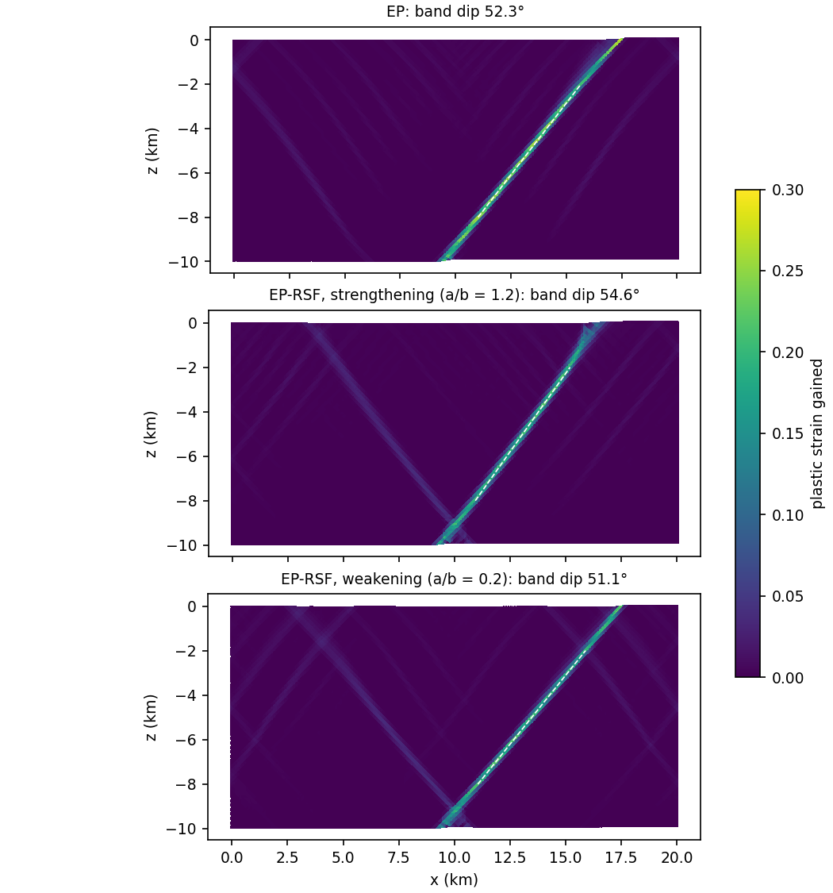
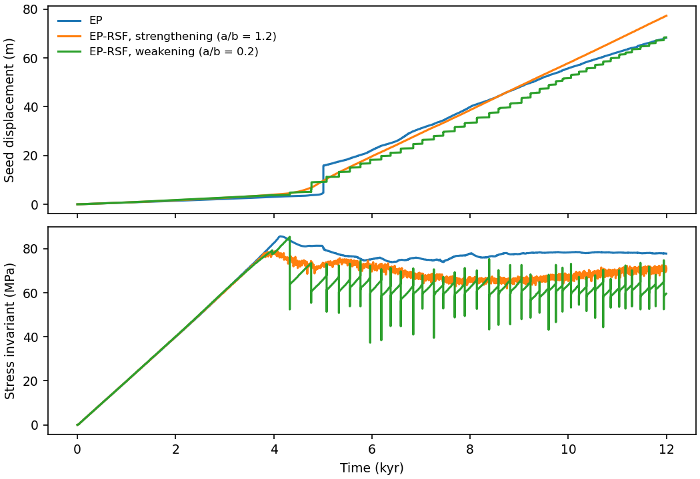

# Shear bands with and without rate-and-state friction

A brittle crust pulled apart from a weak seed localizes into shear bands.
This tutorial runs the same model three times, with static Mohr–Coulomb
friction (EP) and with rate-and-state friction that is velocity
strengthening or velocity weakening (EP-RSF). It asks two questions: does
rate-and-state friction change where and at what angle the bands form, and
does it change how they slip? The inputs are the DES v2 benchmark in
`benchmarks/DESv2.0/rsf/localization/`; see
[rate-and-state friction](../../../theory/rate-state-friction.md) for the
friction law and for global velocity scaling.

:::info At a glance

| | |
| --- | --- |
| Dimension | 2D |
| Build | `make ndims=2` |
| Run time | 35 minutes (EP), 75 minutes (weakening) and 3 hours (strengthening) on 8 threads |
| Inputs | `benchmarks/DESv2.0/rsf/localization/` in the DynEarthSol repository |
| Results | the benchmark results given in its README |

:::

## Setup

| Setting | Value |
| --- | --- |
| Domain | 20 km × 10 km, uniform triangles of 100 m (`meshing_option = 1`) |
| Loading | both sides pulled outward at 0.5 cm/yr each; free top; Winkler support at the base; gravity 10 m/s² |
| Initial state | lithostatic stress; a circular seed of radius 500 m centred at (10, −9.5) km starts with plastic strain 1 |
| Elasticity and density | $K$ = 50 GPa, $G$ = 30 GPa, 2700 kg/m³ |
| Strength | friction angle 30°, no dilation; cohesion softening from 30 to 0.1 MPa over plastic strain 0 to 0.5 |
| Rate-and-state | aging law, $D_c$ = 5 mm, $V_0 = 10^{-9}$ m/s, strain-rate slip measure (`rsf_slip_rate_projection_option = 1`), state limit `rsf_dtheta_max = 0.2` |
| Mechanics | explicit, global velocity scaling with $c = 2\times10^{5}$, damping factor 0.8 |
| Duration | 12,000 years, a frame every 500 years |

The three inputs differ only in the friction law:

| Input | Rheology | $a$ | $b$ | $a/b$ |
| --- | --- | ---: | ---: | ---: |
| `ep_phi30_psi0.cfg` | `elasto-plastic` | – | – | – |
| `ep_rsf_strengthening_phi30_psi0.cfg` | `elasto-plastic-rsf` | 0.018 | 0.015 | 1.2 |
| `ep_rsf_weakening_phi30_psi0.cfg` | `elasto-plastic-rsf` | 0.003 | 0.015 | 0.2 |

For a Mohr–Coulomb material with friction angle $\phi$ and dilation angle
$\psi$, the Arthur angle predicts bands at $45° + (\phi + \psi)/4$ from the
direction of the least compressive stress, here
$45° + 30°/4 = 52.5°$ from the horizontal.

## Input and how to run

Build `dynearthsol2d` in the DES root, then run each input from the
benchmark folder:

```bash
cd benchmarks/DESv2.0/rsf/localization
mkdir -p output
OMP_NUM_THREADS=8 ../../../../dynearthsol2d ep_phi30_psi0.cfg
OMP_NUM_THREADS=8 ../../../../dynearthsol2d ep_rsf_strengthening_phi30_psi0.cfg
OMP_NUM_THREADS=8 ../../../../dynearthsol2d ep_rsf_weakening_phi30_psi0.cfg
```

Each writes to `output/` under its own name: frames `<name>.save.*`,
checkpoints, `<name>.info`, and three monitor files,
`<name>_monitor_point_0.csv` to `_2.csv`, recorded every 1000 steps. Point 1
starts at the seed centre; points 0 and 2 lie near the side walls.

## What to look for

### Where the bands form



All three models break the crust along a band that rises from the seed to
the surface on the right, with a fainter conjugate band on the left. The
band carries most of the extension; the rest of the crust stays elastic.

| Model | Band dip (fit over 2–8 km) |
| --- | ---: |
| EP | 52.4° |
| EP-RSF, strengthening | 54.5° |
| EP-RSF, weakening | 51.2° |
| Arthur angle, $45° + (\phi+\psi)/4$ | 52.5° |

Rate-and-state friction moves the dip by about two degrees at most. The
orientation is set by the Mohr–Coulomb strength, not by the rate
dependence. Velocity strengthening steepens the band slightly; velocity
weakening flattens it slightly.

The dip is measured from the plastic strain gained since frame 0, so the
initial seed does not count. In each 200 m depth row between 2 and 8 km,
take the element with the largest gain on each side of the seed, keep it if
the gain exceeds a quarter of the maximum, and fit a straight line through
the points:

```python
import numpy as np
from Dynearthsol import Dynearthsol

des = Dynearthsol('output/ep_phi30_psi0')
first, last = des.frames[0], des.frames[-1]
x = des.read_field(last, 'coordinate')/1e3          # km
c = des.read_field(last, 'connectivity')
gain = des.read_field(last, 'plastic strain') - des.read_field(first, 'plastic strain')
cen = x[c].mean(axis=1)
zs, xs = [], []
for z0 in np.arange(-8.0, -2.0, 0.2):
    row = (cen[:, 0] >= 10) & (cen[:, 1] >= z0) & (cen[:, 1] < z0 + 0.2)
    i = np.argmax(np.where(row, gain, -np.inf))
    if gain[i] > 0.25*gain.max():
        zs.append(cen[i, 1]); xs.append(cen[i, 0])
slope = np.polyfit(zs, xs, 1)[0]
print('dip', np.degrees(np.arctan(1/abs(slope))))
```

Run it from the benchmark folder with the DES root on `PYTHONPATH`. It gives
the dips in the table to within 0.1°. Use `cen[:, 0] < 10` for the band on
the left; in these runs only the right band passes the threshold over the
whole depth range.

### How the bands slip



The monitor at the seed (`_monitor_point_1.csv`) shows three different
ways of slipping on almost the same band. The stress invariant is
`sqrt(0.25*(stress_0 - stress_1)**2 + stress_2**2)` of the seed element.

- **Loading is the same in all three.** The stress rises linearly for about
  4000 years while the crust deforms elastically.
- **EP fails once, then slides.** The stress peaks at 86 MPa at 4.1 kyr.
  At 5.0 kyr the band breaks through to the surface in one fast slip: the
  seed moves about 12 m at up to 5 cm/s. After that the band slides
  steadily at about 78 MPa.
- **Velocity strengthening creeps.** The stress peaks lower, at 79 MPa at
  4.0 kyr, and the band then slides steadily at about 68 MPa. The seed never
  exceeds 1 cm/s and there are no slip events. The friction coefficient in
  the seed element (`dynamic_friction`) varies between about 0.54 and 0.81
  from one monitor row to the next.
- **Velocity weakening sticks and slips.** The stress reaches 85 MPa before
  the first event at 4.3 kyr. Then 39 events follow until 12 kyr. The gap
  between events shortens from about 440 years to about 180 years after
  8 kyr. In a typical event the seed slips 1.3 m (0.5 to 2.0 m) in about a
  minute at 0.1 to 0.8 m/s, and the stress in the seed element drops by
  5 MPa (up to 21 MPa). Most events are followed a few years later by a slow
  slip of about 0.3 m with no stress drop. Between events the stress
  recovers along a straight line, as in the loading phase.

The boundaries pull at the same rate in all three, and the seed has moved
68 to 77 m by 12 kyr in each. What differs is when that slip happens. Global
velocity scaling lets one run carry both the centuries between events and
the seconds of each event: the time step falls from about $10^{6}$ s
between events to below $10^{-3}$ s during them.

## Limits

- **One element.** The stress and friction histories come from the seed
  element and the displacement from one node. They show the character of
  slip, not the slip distribution along the band.
- **One resolution.** All runs use 100 m elements, so the band is a few
  elements wide. The dips have not been checked at other resolutions.
- **One band.** Only the band on the right is clear enough to fit over
  2–8 km. The conjugate band is weaker in all three models.

## Exercises

- **Change the dilation angle.** Set `dilation_angle0` and `dilation_angle1`
  to 15 and compare the dips with the Arthur angle, now 56.25°.
- **Move $a/b$ through 1.** Run $a$ = 0.012, 0.015 and 0.016 with
  $b$ = 0.015 and find where the slip events stop.
- **Count the events.** With `sim.seismic_moment_calculate_output = yes`
  the weakening case writes each event's moment to
  `seismic_moment_magnitude.txt`. Compare it with the seed slip in the
  monitor file.
