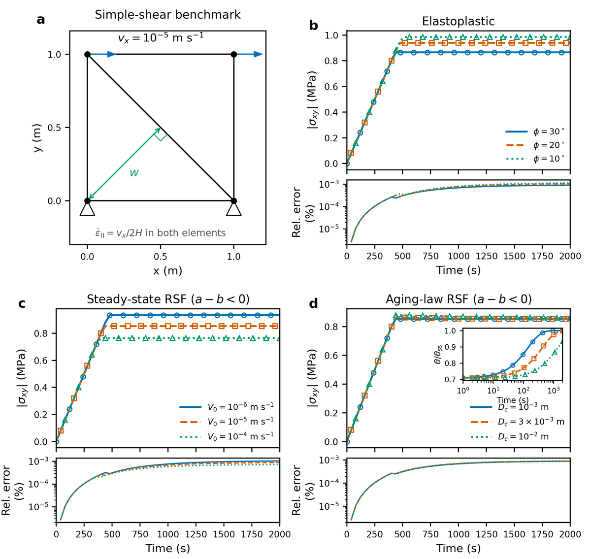

# Checking the friction law in simple shear

Before you trust an earthquake-cycle model, check that DES reproduces the
friction law itself. This benchmark shears a single square cell at a known
rate. With every node velocity prescribed, there is no wave, localization or
mesh effect, so the stress, friction and state can be compared directly with
closed-form solutions. It runs in about half a minute.

The benchmark covers four groups:

| Group | Cases | Varied |
| --- | --- | --- |
| Elastoplastic (static friction) | 3 | friction angle 10°, 20°, 30° |
| Steady-state RSF (`state_var_model = 0`) | 3 | $V_0 = 10^{-6}, 10^{-5}, 10^{-4}$ m/s |
| Aging-law RSF (`state_var_model = 1`) | 3 | $D_c = 10^{-3}, 3\times10^{-3}, 10^{-2}$ m |
| Healing at zero slip rate | 1 | – |

See [rate-and-state friction](../../../theory/rate-state-friction.md) for the
equations used below.

:::info At a glance

| | |
| --- | --- |
| Dimension | 2D |
| Build | `make ndims=2` |
| Run time | about 30 s for all cases, one thread |
| Inputs | `benchmarks/simple_shear_rsf/` in the DynEarthSol repository |
| Checked with | DynEarthSol `68cc2a0` |

:::

## Setup



*Figure 1.* (a) The cell: two triangles in a 1 m square. The bottom nodes are
fixed and the top nodes move at $v_x = 10^{-5}$ m/s. (b–d) Shear stress
from DES (lines) and the reference (markers), with the relative error
below each panel. The inset in (d) shows the state variable relative to its
steady-state value.

| Setting | Value |
| --- | --- |
| Cell | 1 m × 1 m, two triangles, plane strain |
| Loading | top moves at $v_x = 10^{-5}$ m/s; bottom fixed |
| Bulk and shear moduli | 200 MPa and 200 MPa |
| Cohesion | 1 MPa, no weakening; zero dilation; no gravity |
| RSF parameters | $\phi_0 = 30°$, $a = 0.2$, $b = 0.3$ |
| Slip-rate measure | strain-rate invariant (`control.rsf_slip_rate_projection_option = 1`) |
| Time step | fixed, 0.01 s, 200,000 steps (2000 s, shear strain 0.02) |

The large $a$ and $b$ make the differences between cases easy to see. The
cell deforms isochorically and without gravity, so the mean stress stays
zero and the Mohr–Coulomb shear strength is $\tau_y = c\cos\phi$ with
$\phi = \arctan\mu$.

## Reference solutions

**Stress.** The cell loads elastically and then flows at its strength:

$$
\tau(t) = \min\!\left(G\,\frac{v_x t}{H},\ c\cos(\arctan\mu)\right),
$$

with $\mu = \tan 30°$ for the elastoplastic cases and the RSF friction
coefficient otherwise.

**Slip rate.** In the shearing two-triangle cell the strain-rate measure
gives

$$
V(t) = \frac{v_x}{\sqrt{(1 - v_x t/H)^2 + 1}},
$$

because the element width $w$ changes as the cell shears.

**Steady state.** $\mu = \mu_0 + (a-b)\ln(V/V_0)$ at the current $V$.

**Aging law.** With $\Phi(t) = \int_0^t V/D_c\,dt'$, the aging law has the
solution

$$
\theta(t) = e^{-\Phi(t)}\left(\theta_0 + \int_0^t e^{\Phi(t')}\,dt'\right),
\qquad \theta_0 = D_c/V_0,
$$

which the reference evaluates by quadrature. The friction follows from the
full law.

**Healing.** A separate run holds the cell still for 1546 steps of three
days ($D_c = 10^{-2}$ m, $V_0 = 4\times10^{-9}$ m/s). The slip rate is then
the $10^{-16}$ m/s floor and the state grows almost linearly with time,
$\theta \approx \theta_0 + t$. The check iterates DES's discrete update
independently.

## Input and how to run

Build `dynearthsol2d` in the DES root, then:

```bash
cd benchmarks/simple_shear_rsf
python3 run_simple_shear_benchmark.py --clean --aging-transient --healing
python3 plot_simple_shear_benchmark.py -o simple_shear_benchmark.png
```

The runner writes one input file per case from `simple_shear_base.cfg`,
which holds placeholders for the values in the table above, and runs DES in
`runs/<case>/`. `--aging-transient` adds three runs with dense monitor output
for the inset in panel (d); `--healing` adds the zero-velocity run. Pass
`--exe /path/to/dynearthsol2d` if the executable is elsewhere.

For a pass/fail check without plotting:

```bash
python3 check_simple_shear_benchmark.py          # one steady, one aging, healing
python3 check_simple_shear_benchmark.py --all    # all nine cases and healing
```

Add `--pt` to run the same cases with PT mechanics.

The key RSF lines in a generated input are:

```ini
[control]
use_global_velocity_scaling = true
rsf_slip_rate_projection_option = 1
fixed_dt = 0.01

[mat]
rheology_type = elasto-plastic-rate-state-friction
direct_a = [0.2]
evolution_b = [0.3]
characteristic_velocity = [1e-05]
characteristic_distance = [0.001]
state_var_model = 1

[monitor]
enabled = yes
num_points = 2
output_stress = yes
output_dynamic_friction = yes
output_state_variable = yes
```

## Output

Each `runs/<case>/` holds the input, the DES output and two monitor files,
`monitor_point_0.csv` and `monitor_point_1.csv`, one per element. Their
columns include `stress_0`, `stress_1`, `stress_2` (σxx, σzz, σxz),
`dynamic_friction` and `state_variable`. The plot script compares the mean
absolute shear stress of the two elements with the reference and writes
`simple_shear_benchmark_metrics.csv`.

## Result

In every case DES follows the reference through loading, yield and flow.
The largest difference over the run is about 0.001 % of the reference
stress:

| Case | Maximum error (%) |
| --- | ---: |
| Elastoplastic, φ = 30°, 20°, 10° | 0.00091, 0.00106, 0.00116 |
| Steady state, $V_0$ = 10⁻⁶, 10⁻⁵, 10⁻⁴ m/s | 0.00105, 0.00089, 0.00072 |
| Aging law, $D_c$ = 10⁻³, 3×10⁻³, 10⁻² m | 0.00089, 0.00089, 0.00091 |

The checker also recovers the slip rate DES used from the monitored friction
and state; it matches $V(t)$ to a relative error of $5\times10^{-8}$. The
healing run matches the discrete update exactly.

Things to notice in the figure:

- **Panel (b).** A lower friction angle gives a higher strength here,
  because $\tau_y = c\cos\phi$ at zero mean stress. Friction only adds
  strength through normal stress, and this cell has none.
- **Panel (c).** With $a - b < 0$, a larger $V_0$ means the cell slides
  slower relative to the reference rate, so the friction is higher and the
  strength $c\cos\phi$ lower.
- **Panel (d).** All three $D_c$ values reach nearly the same stress, but
  the state approaches steady state more slowly for larger $D_c$ (inset):
  the slip needed to renew the contacts is larger.

## Limits

This benchmark checks the constitutive update in a homogeneous cell with
prescribed motion. It does not test localization, wave propagation, mesh
dependence or the coupling between slip and elastic unloading that controls
earthquake nucleation. Under PT, the prescribed motion balances the forces
at the first iteration, so the PT run checks the accepted constitutive
history, not iterative convergence. The [earthquake-cycle
tutorial](./earthquake-cycles.md) adds those effects.
