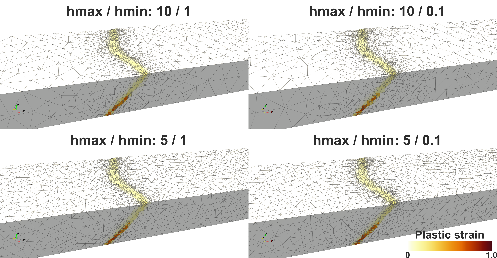

# Adaptive mesh refinement with MMG

## In a nutshell,

- With `usemmg = 1` in `Makefile`, MMG is pulled in as a git submodule and built
  automatically; no separate MMG install or `MMG_INCLUDE`/`MMG_LIB_DIR` setup is needed.
- `mesh.smallest_size` and `mesh.largest_size` set MMG's minimum and maximum element
  edge length, as a multiple of `mesh.resolution` (the same two parameters also bound
  `meshing_option = 2`'s coarse zone):

	- `largest_size = 30` (default): the largest element has edge length
	  `largest_size^(1/NDIMS) * resolution`
	- `smallest_size = 0.01` (default): the smallest element has edge length
	  `smallest_size^(1/NDIMS) * resolution`
- Remeshing with MMG is **conservative by default**: a remesh freezes (keeps as-is)
  every quiet element and only refines, repairs, or coarsens the elements that a
  specific rule flags, chiefly ones whose plastic strain grew since the last remesh.
  This replaces an earlier, simpler scheme that rebuilt the whole mesh from a
  plastic-strain-scaled size field every remesh. See
  [Conservative remeshing](#conservative-remeshing-freeze--required-policy) below.

:::danger `mmg_hmin_factor` and `mmg_hmax_factor` are retired
These two parameters no longer exist; using them now exits with "unknown or retired
key." Use `mesh.smallest_size`/`mesh.largest_size` instead. To keep the same element
sizes as before, convert the old values: `largest_size = mmg_hmax_factor^NDIMS` and
`smallest_size = mmg_hmin_factor^NDIMS / mmg_remesh_defensive_tiny_ratio` (the old
defaults, `mmg_hmax_factor = 2.0`/`mmg_hmin_factor = 0.2`, convert to
`largest_size = 4`/`smallest_size = 0.0267` in 2D and `largest_size = 8`/
`smallest_size = 0.00533` in 3D, using the new default `mmg_remesh_defensive_tiny_ratio = 1.5`).
:::

## Screenshots
- `examples/core-complex-mmg.cfg`
- `param.mesh.resolution`: 1 km



## Technical details

### Parameters for MMG

- `mmg_debug`: Turn on/off *debug* mode. In debug mode, MMG checks if all structures are allocated.
- `mmg_verbose`: Level of verbosity, -1 to 10.
- `mesh.smallest_size`/`mesh.largest_size`: set MMG's minimum/maximum element edge
  length (see above); not MMG-specific, they also bound `meshing_option = 2`'s coarse zone.
- `mmg_hausd_factor`: Global Hausdorff distance (on all boundaries in the mesh), as a
  factor of `mesh.resolution`. Roughly speaking, the allowed difference between the
  boundary before and after mesh refinement or optimization. At the default 0.01, MMG
  refines a sharply bent free surface down to its size floor and can trigger the
  tiny-element check at nearly every quality pass; use 0.02-0.05 along a 3D fault scarp
  and 0.1 on the top/wall ridges next to restored side walls.

For more MMG parameters, refer to https://mmgtools.github.io/libmmg3d_8h.html#a964a06109019542d04f12263c3fae24d

For instance,
```JSON
mmg_debug = 0
mmg_verbose = 0
mmg_hausd_factor = 0.01
```

### Conservative remeshing (freeze / required policy)

With `usemmg = 1`, every remesh now defaults to **conservative**: it starts by
assuming every element is frozen (kept exactly as it is) and only refines, repairs,
or frees the elements a specific rule flags. This replaces an earlier scheme that
rebuilt the whole mesh from a plastic-strain-scaled size field at every remesh,
which diffused and coarsened the quiet far field over time.

In plain terms, by default:

- An element whose plastic strain grew by more than `mmg_remesh_active_plstrain`
  since the last remesh is split (its existing nodes are kept, so the band's strain
  carries over exactly).
- A distorted or tiny element is repaired by moving its nodes.
- An element far from its current size target is freed to coarsen or split.
- Most boundary nodes stay pinned; `remeshing_option = 13`'s restored side walls and
  the bottom boundary never move except through the specific rules that are allowed to.

| Parameter | Default | Effect |
|---|---|---|
| `mmg_remesh_active_plstrain` | 0.01 | Plastic-strain increment since the last remesh above which an element is split. Raise it to freeze more of a band; lower it (keep it > 0) to split more. |
| `mmg_remesh_defensive_quality_ratio` | 1.5 | Repairs an element once its quality falls below `min_quality` times this ratio, before it hits the remesh-triggering `min_quality` itself. 1 repairs only once the trigger is reached. |
| `mmg_remesh_defensive_tiny_ratio` | 1.5 | Gap, in element size, between the tiny-element remesh trigger and the smallest element MMG will build. Lower (minimum 1) means less of a gap, so back-to-back remeshes are more likely. |
| `mmg_remesh_size_recovery_ratio` | 1.4 | A quiet element finer than this factor times its size target is freed to coarsen. `0` disables size recovery (and the t = 0 weak-zone refinement); values above 1 free fewer fossil-fine elements. |
| `mmg_metric_refine_coeff` | 5 | Plastic-strain sensitivity of the target element size: target volume scales by `1/(1 + coeff * plastic_strain)`. `0` disables plastic refinement from a fresh start. Higher meshes a strained zone finer, at the cost of more elements and often a shorter time step. |
| `mmg_metric_refine_recover` | no | `no` (default): once refined, a node keeps its finest size target even as plastic strain there drops. `yes`: the target tracks the current plastic strain instead, so a refined zone can coarsen again. |
| `mmg_aniso_wall_ratio` | 0 (off) | At a `remeshing_option = 13` restored inflow wall, `>= 1` coarsens elements normal to the wall while keeping them fine along it (an aspect ratio), so an incoming column is carried by fewer, wider elements. |

Start from `examples/core-complex-mmg.cfg`, which lists every MMG key with a
one-line hint. `mmg_metric_refine_coeff` and `mmg_remesh_active_plstrain` are the
two most worth tuning first; in 3D, also `mmg_hausd_factor`.

:::caution Breaking: old checkpoints cannot restart
Conservative remeshing persists new per-node/per-element state (plastic strain since
the last remesh, size targets) in the checkpoint. A checkpoint written before this
change does not have that state, and restarting from it exits with a restart-mismatch
error (see [Checkpointing and restart](../usage/run#checkpointing-and-restart)).
Finish or discard runs on the old binary before upgrading.
:::

### Using MMG for remeshing

One needs to set `usemmg` to `1` in `Makefile`:
```Makefile
usemmg = 1
```

`make prepare` then pulls MMG in as a git submodule and builds it under `mmg/build`
automatically, no manual MMG install or path configuration needed. `Makefile` points
the build at that submodule:
```Makefile
ifeq ($(usemmg), 1)
        # path to MMG3D header files
        MMG_INCLUDE = ./mmg/build/include

        # path of MMG3D library files
        MMG_LIB_DIR = ./mmg/build/lib

        MMG_CXXFLAGS = -I$(MMG_INCLUDE) -DUSEMMG
        ifeq ($(ndims), 3)
                MMG_LDFLAGS = -L$(MMG_LIB_DIR) -lmmg3d
        else
                MMG_LDFLAGS = -L$(MMG_LIB_DIR) -lmmg2d
        endif
        ifneq ($(OSNAME), Darwin)  # Apple's ld doesn't support -rpath
                MMG_LDFLAGS += -Wl,-rpath=$(MMG_LIB_DIR)
        endif
endif
```

```Makefile
ifeq ($(usemmg), 1)
        CXXFLAGS += $(MMG_CXXFLAGS)
        LDFLAGS += $(MMG_LDFLAGS)
endif
```

When `USEMMG` is defined during the build process with `-DUSEMMG`, `remesh()` function calls `optimize_mesh()`, not `new_mesh()`.

```C++ {6} showLineNumbers
void remesh(const Param &param, Variables &var, int bad_quality)
{
...
#ifdef THREED
#if defined ADAPT || defined USEMMG
        optimize_mesh(param, var, bad_quality, old_coord, old_connectivity,
                 old_segment, old_segflag);
#else
        new_mesh(param, var, bad_quality, old_coord, old_connectivity,
                 old_segment, old_segflag);
#endif
...
```

### `optimize_mesh()`

#### Options for the bottom boundary

The option `param.mesh.remeshing_option` determines what to do to the bottom boundary during remeshing. However, it does not directly control how MMG performs mesh optimization. 

```C++
/* choosing which way to remesh the boundary */
    switch (param.mesh.remeshing_option) {
    case 0:
        // DO NOT change the boundary
        excl_func = &is_boundary;
        break;
    case 1:
        excl_func = &is_boundary;
        flatten_bottom(old_bcflag, qcoord, -param.mesh.zlength,
                       points_to_delete, min_dist);
        break;
    case 2:
        excl_func = &is_boundary;
        new_bottom(old_bcflag, qcoord, -param.mesh.zlength,
                   points_to_delete, min_dist, qsegment, qsegflag, old_nseg);
        break;
    case 10:
        excl_func = &is_corner;
        break;
    case 11:
        excl_func = &is_corner;
        flatten_bottom(old_bcflag, qcoord, -param.mesh.zlength,
                       points_to_delete, min_dist);
        break;
    case 12:
        flatten_x0(old_bcflag, qcoord, points_to_delete);
        break;
    default:
        std::cerr << "Error: unknown remeshing_option: " << param.mesh.remeshing_option << '\n';
        std::exit(1);
    }
```

#### Workflow during remeshing with MMG

1. Initialization
2. Mesh building in MMG5 format
3. Metric field building: each node's target element size comes from the
   freeze/required policy described in
   [Conservative remeshing](#conservative-remeshing-freeze--required-policy) above,
   not a single global formula.
4. Mesh optimization
5. Mesh-related data update using the optimized MMG5 mesh

---

## Using MMG for initial mesh generation

For large 3D models (roughly >5 million elements), TetGen can be slow or
crash during the initial mesh generation step. DES3D supports an
optional two-stage initialization that uses TetGen to create a coarse
seed mesh and then refines it with MMG to the target resolution.

Enable it in your config file:

```cfg
use_mmg_init = 1
mmg_init_coarsening_factor = 10.0   # TetGen seed element volumes scaled by factor^NDIMS
```

`use_mmg_init` is only effective when DES3D is compiled with `usemmg = 1`.
If MMG support is absent, the parameter is silently ignored and the standard
TetGen path is used.

| Parameter | Default | Description |
|-----------|---------|-------------|
| `use_mmg_init` | `0` | Set to `1` to enable two-stage MMG initialization (requires `usemmg = 1`) |
| `mmg_init_coarsening_factor` | `10.0` | TetGen builds its coarse seed mesh with element volumes scaled by `factor^NDIMS`; MMG then refines it to the target resolution. Higher = smaller coarse mesh = faster TetGen but more MMG work. |

:::tip When to use
Enable `use_mmg_init` when your 3D model has more than ~2 million target
elements and TetGen initialization takes more than a few minutes or
produces memory errors.
:::
